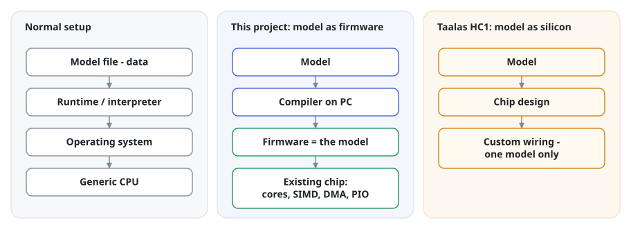
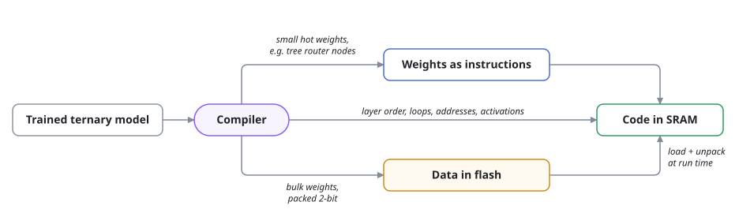
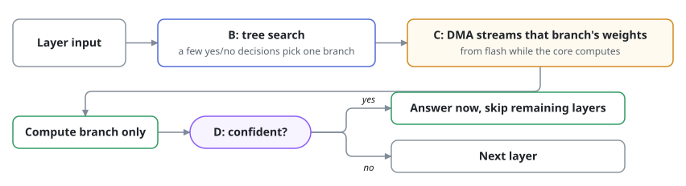
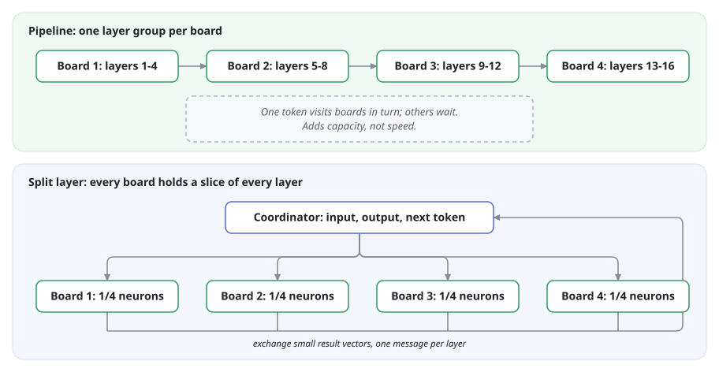
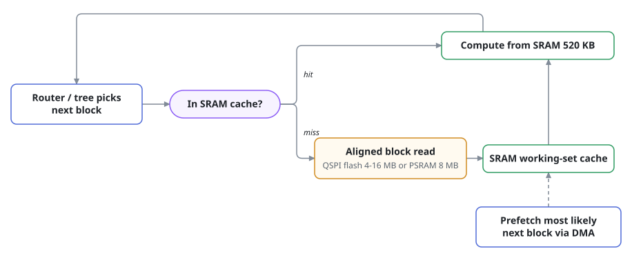
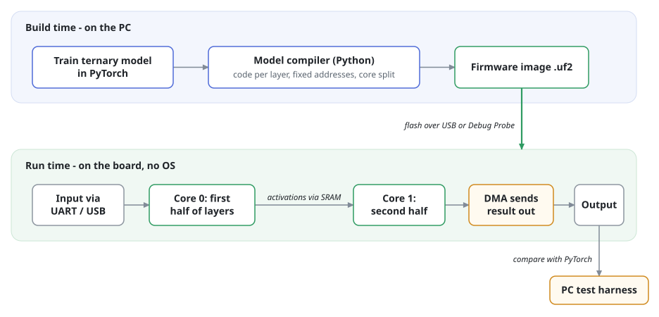
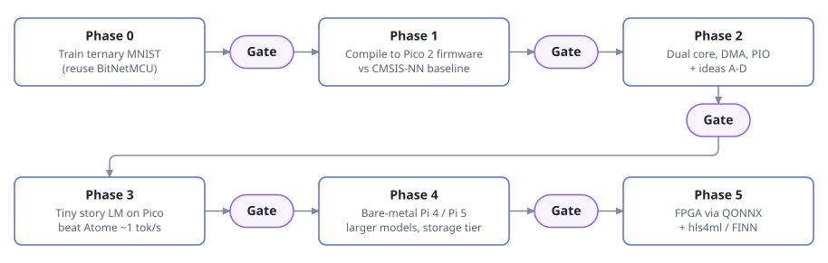

# Model-as-Firmware: Feasibility Study

*Nov 3, 2026*

> **Corrections from measurement (added 14 Nov 2026).** This study was written before any measurement and is kept as written. Where later results contradict it, they win:
>
> - **Atome's speed is not limited by flash on the Pico 2** (contrary to "What already exists" and idea G's motivation).
>   - It is compute-bound: from SRAM it is only 10% faster.
>   - Its engine recomputes the whole context for every token and spends ~17 cycles per weight.
>   - It reads 1.3 MB from flash per token, not ~270 KB.
>   - Flash does matter once the engine is efficient: our dense story model is 3.1x slower from flash than from SRAM (notes/lm.md).
> - **Weights as code cost about 5.6–6 bytes per non-zero weight, not 2–4** (FINDINGS F16, F17). The code-size estimates below are about 2x too low.
> - **The hybrid that won (F20) is different from the one proposed here.** The linear layers, whose weights are used once per inference, become code in SRAM. The conv weights, which are reused, stay as data.
> - **Not every compute unit is used yet:** both cores, SIMD/DSP and DMA are; PIO isn't.
> - **Energy has not been measured.** The USB power meter can't resolve the Pico 2 (0–4 mA in 1 mA steps); it needs an INA226 breakout or a Nordic PPK2.
> - **Fast feedforward speedups are much smaller here than the published 78x / 220x,** which are for the feedforward layers alone on large models:
>   - MNIST tree layer: 3.4–6.2x (F25).
>   - Story model: the feedforward stage about 5–6x, the whole token 1.7–2.5x (F26).
> - **"Phase 3 has largely been done already" (Atome) was too strong.** Atome has no feedforward layer for idea B, and its engine is not a strong baseline. Phase 3 trained its own model. The controlled language-model result is the dense/tree twin comparison; there is no strong external language-model baseline (notes/lm.md, "Fairness of the Atome comparison").
> - **Phase 3's target ("beat Atome's ~1 tok/s") was met** with a different model and a different engine, so it is not a like-for-like result.
> - **The verdict below, checked claim by claim at Gate 3** (notes/FINDINGS.md, "Gate 3"): feasible as a proof of concept for speed on models that fit the Pico 2's SRAM. Weights as code are shown on MNIST only. The story model keeps its weights as data by design; all of them as code would need about 3 MB, and code for its small matrices was not tried.

## Verdict

**Feasible as a proof of concept, with one honest caveat.** You can build a board whose firmware *is* the model: no OS, no runtime, no model file, weights compiled straight into machine instructions, and every compute unit on the chip used. People are already running language models bare-metal on Raspberry Pi 4, Pi 5 and even four Pi Zeros wired together, so the foundation is proven.

The caveat: a chip like Taalas HC1 gets its \~70x gain by changing the silicon itself. On an existing board the circuits are fixed, so the realistic gain comes from removing software overhead and memory traffic, not from new circuits. Expect a solid improvement over a standard embedded runtime on small models, not a 70x leap. Verification also showed the gain is limited to models whose generated code fits in on-chip SRAM; larger models need a hybrid approach (see Verification findings).

The real payoff is the path: the **model compiler** you build here (model in, firmware out) is the same tool you would later point at an FPGA, where weights *can* become physical logic. That is the closest you can get to "printing the model into the chip" without making a chip.

**Recommended first board:** Raspberry Pi Pico 2 (RP2350, about $6). **First target:** a ternary MNIST classifier, then a tiny story-writing language model.

## The idea in one picture

A hardwired chip removes every layer between the model and the transistors. This project removes the same layers in software, on a chip you can already buy.

<picture>
  <source media="(prefers-color-scheme: dark)" srcset="docs/diagrams/three-ways-dark.svg">
  
</picture>

In a normal setup the model is data that a runtime interprets on top of an OS. Here a compiler on your PC turns the model into the program itself, which boots straight on the board and drives every compute unit. Taalas goes one step further and turns the program into wiring, which is why it is faster but can only ever run one model.

## What already exists

Each piece of the idea has been shown separately; nobody has yet combined model-as-code, low-bit weights and full use of a board's side engines in one system. That combination is the novel part.

| Project | Hardware | What it proves | Relevance |
| --- | --- | --- | --- |
| [Taalas HC1](https://rits.shanghai.nyu.edu/ai/taalas-hc1-hardwiring-llama-3-1-into-silicon-for-17000-tokens-second/) | Custom 6 nm ASIC | Llama 3.1 8B hardwired into silicon, up to \~17,000 tokens/s per user vs \~230 on an Nvidia H200 | The inspiration; only runs one model |
| [InferPi](https://github.com/siddharthjthapa/InferPi) | Raspberry Pi 4 | Bare-metal LLM engine: 4 cores + NEON, UART console, own USB and FAT32 stack, no OS | Pi-class bare metal works today |
| [PiTorch](https://hn.jakechampion.name/reader/https://masonjwang.com/projects/pitorch) | 4x Pi Zero cluster | Bare-metal LLM inference and training; GPU (12 QPUs) programmed in assembly | Hidden GPU is usable without an OS |
| [NightRun](https://letsdatascience.com/news/nightrun-boots-local-llms-without-a-conventional-os-b46d8273) | Pi 5 / x86 | Boots straight from firmware into a quantised LLM chat | Removes the OS layer end to end |
| [Pi 5 QPU runtime (MLSys 26)](https://arxiv.org/html/2606.09905v1) | Pi 5 VideoCore VII | Integer matrix multiply on the GPU up to \~94x faster than NumPy on the CPU at 1024 size | The Pi GPU is a real accelerator |
| [10-cent RISC-V MCU network](https://gwern.net/doc/www/cpldcpu.wordpress.com/2caa403f2b8648b5d69eb9d973bb2cd075167b22.html) | CH32V003 (2 KB RAM, 16 KB flash) | Low-bit network with no multiplications, 13.7 ms per image | Multiply-free models fit tiny chips |
| [BitNet b1.58 / Bitnet.cpp](https://export.arxiv.org/pdf/2502.11880) | CPUs | Ternary weights (-1, 0, +1) turn multiplies into add/subtract | The model format that suits fixed hardware |
| [BitROM](https://arxiv.org/pdf/2509.08542) | Research chip | Ternary weights stored in ROM cells, never reloaded | Academic version of "weights in silicon" |
| [OpTC](https://arxiv.org/pdf/2404.15833), [X-CUBE-AI](https://st.com/en/embedded-software/x-cube-ai.html) | Microcontrollers | Model converted to generated C instead of an interpreter | Code generation beats runtime interpreters |

## Who else is working on this

Every building block is actively worked on, and two of them are already in production; the gap is the combination on cheap boards, not any single technique.

| Approach | Main players | Status (Nov 2026) | What it means for this project |
| --- | --- | --- | --- |
| Model hardwired into a custom chip | [Taalas HC1](https://sovereignmagazine.com/article/taalas-hc1-ai-chip) | Commercial; an independent test measured 14,357 tokens/s on Llama 3.1 8B | The end goal, but needs a chip per model |
| Model hardwired into an FPGA | [hls4ml](https://indico.desy.de/event/24227/contributions/53045/attachments/65067/80284/ml_l1_13tdw.pdf) (CERN / Fermilab) | In production: models in [\~1,000 FPGAs and ASICs](https://www.pulse.bot/ai/news/cern-burns-ultrasmall-ai-models-into-silicon-to-filter-lhc-data-in-real-time-de610162-72ce-4a14-8459-9f9363051c4e) of the LHC trigger; models are tiny (hundreds to thousands of weights) | Phase 5 already exists; reuse it |
| Model unrolled into FPGA dataflow | [FINN](https://xilinx.github.io/finn) (AMD Research) | Open source, under active development, in industrial evaluation | Same: reuse, don't rebuild |
| Model compiled to code, not interpreted (MCU) | [Edge Impulse EON](https://docs.nordic.edgeimpulse.com/studio/projects/deployment/eon-compiler), [TinyEngine](https://awesome.ecosyste.ms/projects/github.com%2Fmit-han-lab%2Ftinyengine) (MIT) | EON is commercial (Enterprise plan only); TinyEngine last pushed Nov 2024 | Strong baselines; both still keep weights as data arrays |
| Ternary networks on MCUs | [BitNetMCU](https://github.com/cpldcpu/BitNetMCU), [BitNeural32](https://github.com/Aizhee/python-bitneural32) | Working hobby/open-source tools; weights packed 2 bits each as data | Proves the model format; not weights-as-code |
| Ternary language models on MCUs | [Atome LM](https://github.com/TilelliLab/atome-lm), [ESP32-S3 LLM Cluster](https://github.com/Low-Zi-Hong/ESP32s3-LLM-Cluster) | Early: Atome runs on real ESP32 silicon; the cluster pipeline works but its model is untrained | Phase 3 has largely been done already (details below) |
| Bare-metal LLMs on Raspberry Pi | InferPi, PiTorch, NightRun | Hobby projects; a 2026 paper says no end-to-end runtime for the Pi GPU exists yet | Phase 4 is still open ground |
| Code specialised to known weights (CPU) | [SparseDNN](https://arxiv.org/pdf/2101.07948) (Stanford) | Research, 2021, open source | The closest existing evidence for weights-as-code (below) |

## Verification findings (GitHub and arXiv, Nov 2026)

**Bottom line: no project found compiles each weight into its own instruction on a microcontroller or Pi, so that part is still open. But the check exposed a serious flaw: on flash-bound boards, weights-as-code can make large models slower, not faster.** Absence from search is not proof of absence; re-check before publishing anything.

### What the closest projects show

| Project | What it does | Measured result | Lesson |
| --- | --- | --- | --- |
| [Atome LM](https://github.com/TilelliLab/atome-lm/releases/tag/esp32-silicon-v1) | 944K-weight ternary LM, bit-exact Python to C, on a real ESP32 | About 1.0 token/s; speed limited by flash, \~270 KB of ternary weights read per token | A tiny LM on a $2-class MCU is done; its author calls \~1 token/s known territory |
| [Atome scale-up A/B](https://raw.githubusercontent.com/TilelliLab/atome-lm/main/FRONTIER.md) | Ternary vs normal FP32 model at equal size | Ternary wins at 60K weights, loses by \~11% at 944K | Ternary quality cost grows with size; measure it, don't assume |
| [ESP32-S3 LLM Cluster](https://pinggy.io/blog/esp32_s3_bitnet_llm_cluster/) | 0.5B ternary model split over 7 boards | \~1.3 s per board, so several seconds per token; shipped model emits random tokens | More boards add capacity, not speed; flash reads dominate |
| [BitNetMCU](https://github.com/cpldcpu/BitNetMCU) | Low-bit MNIST on a CH32V003 | Over 99% accuracy, no multiplies, 2 KB RAM, 16 KB flash | Ready-made Phase 0 training pipeline |
| [SparseDNN](https://arxiv.org/pdf/2101.07948) | Generates code specialised to each layer's known zero pattern (x86) | Breaks even with dense code at \~70% zeros; \~4x faster at 95% zeros | The closest proof that weight-specific code pays, but only when most weights are zero |

### The flaw this exposes

Packed ternary weights cost 2 bits each. As instructions, each non-zero weight costs roughly 2-4 bytes, about 8-16x more bytes (my estimate, to be measured in Phase 1). Atome and the ESP32 cluster both show that speed on these boards is set by how many bytes come out of flash per token. So if the generated code does not fit in on-chip SRAM, weights-as-code reads *more* flash per token and should run *slower* than a packed ternary engine.

Where it can still win: when the generated code fits in SRAM (on the Pico 2, well under 520 KB, so small models only), or when training pushes most weights to zero, which SparseDNN puts at 70% or more.

### What changes in the plan

1. **Phase 0:** start from BitNetMCU's training code instead of writing it; add Atome LM as the language-model baseline.
2. **Phase 1:** measure bytes fetched per inference, not only speed; train with high sparsity (70%+) as a second variant.
3. **Hybrid mode is now core, not optional:** the compiler must choose per layer between code and packed weights, based on SRAM fit.
4. **Phase 3 is re-scoped:** the goal is beating Atome's \~1 token/s on the same model size, not "first LM on an MCU".
5. **Phase 5:** output QONNX and build on hls4ml or FINN instead of a custom FPGA back end.

**Still unknown:** whether anyone has done per-weight code generation on Arm Cortex-M privately or in a paper not indexed by search; and the real code-size ratio, which only Phase 1 can measure.

## Skipping zero weights (sparse storage)

Not storing zero weights at all cuts memory use and flash reads, which is the real bottleneck on these boards; the catch is that every non-zero weight must record *where* it belongs, and that position can cost more than the weight.

**How it works.** The program never searches for a weight. It walks a list of only the non-zero weights, and each entry says "add (or subtract) input number X". Zero weights are never read and never computed. This suits microcontrollers: they read on-chip SRAM at the same speed in any order, so jumping to input X is cheap, unlike on a PC where it causes cache misses.

| Format | How zeros are skipped | Cost | Best when |
| --- | --- | --- | --- |
| Packed 2-bit (baseline) | Not skipped | 2 bits per weight | Few zeros |
| Bitmap + sign | 1 bit marks zero or not; each non-zero adds a sign bit | 1 bit per weight + 1 per non-zero | Moderate share of zeros |
| Skip list | Each non-zero stores how many zeros came before it (4 bits) + sign | 5 bits per non-zero | Most weights are zero |
| Structured N:M (e.g. 3:4) | Training forces a fixed pattern, so positions are predictable | About 1.25 bits per weight ([Sherry](https://arxiv.org/pdf/2601.07892)) | SIMD and branch-free decoding |
| Weights as code | A zero emits no instruction | About 24 bits per non-zero | Only when the code fits in SRAM |

Storage for 1M ternary weights, in KB (calculated from the format costs above; lower is better):

| Zeros | Packed 2-bit | Bitmap + sign | Skip list | Weights as code |
| --- | --- | --- | --- | --- |
| 0% | 244 | 244 | 610 | 2930 |
| 25% | 244 | 214 | 458 | 2197 |
| 50% | 244 | 183 | 305 | 1465 |
| 75% | 244 | 153 | 153 | 732 |
| 90% | 244 | 134 | 61 | 293 |
| 95% | 244 | 128 | 31 | 146 |

A bitmap is never worse than 2-bit packing, and the skip list overtakes it once three quarters of the weights are zero. Weights-as-code only becomes competitive at very high sparsity. Two simplifications to remember: denser 1.58-bit packing (5 weights per byte) would sit a fifth below the packed line, and skip lists need an escape code for gaps longer than 15 zeros.

### Why work on it

- It attacks the measured bottleneck (bytes read from flash per token), unlike weights-as-code, which adds bytes.
- It combines naturally with ternary weights and with the per-layer hybrid choice the compiler already needs.
- The formats are known from hardware research ([EIE](https://arxiv.org/pdf/2306.09552), [structured sparse ternary coding](https://arxiv.org/pdf/1707.03684)); what is open is choosing among them per layer, automatically, on cheap microcontrollers.

### Why it might not pay off

- **Decoding costs cycles.** Unpacking bitmaps or skip counts adds work and branches; if that costs more than the bytes it saves, there is no gain.
- **Zeros must be trained in.** High sparsity (70-90%) needs pruning during training and may cost accuracy.
- **Irregular patterns resist SIMD.** Structured N:M patterns fix this but constrain the model.

### Experiment plan (alongside Phase 1, est. 2-3 weeks)

1. Train ternary MNIST models with the BitNetMCU pipeline at three sparsity levels: as trained, \~70% zeros and \~90% zeros, plus one 3:4 structured model.
2. Export each model in all five formats; the compiler emits one decoding kernel per format.
3. Run every combination on the Pico 2 twice: weights in external flash, and weights copied to SRAM.
4. Measure per inference: bytes stored, bytes read, cycles, accuracy against PyTorch, and energy.
5. Fit a simple cost model (bytes read + decode cycles) so the compiler can pick the format per layer automatically.

**Success:** a sparse format runs at least 1.5x faster than packed 2-bit with weights in flash, losing no more than 1 point of accuracy (both targets to revise after Phase 0). **Stop signal:** if decoding outweighs the saved reads at every sparsity level, keep packed weights and drop this branch.

## Ideas to test

Eight candidate improvements, each tested on its own against the current design and kept only if it measurably helps; none of them replaces anything above. All five aim at the same bottleneck: bytes read from flash per answer.

| Idea | What it changes | Novelty on small boards | Expected gain | Main risk |
| --- | --- | --- | --- | --- |
| A. Structure as code, weights as data | Only small, hot weights become instructions | Low (existing compilers do the split) | Keeps code small; enables B-D | Unpacking cost per weight |
| B. Tree search over neurons (FFF) | Each layer computes one branch of a neuron tree | High: no microcontroller project found | Largest: only the chosen branch is read | Unproven for small text-generating models |
| C. Streaming with DMA | Next weights load while the core computes | Low: standard engineering | Up to \~2x when read and compute times match | No gain if flash-bound already |
| D. Early exit on confidence | Stop at a layer once the answer is confident | Low on MCUs, proven elsewhere | Up to 2-3x in published LLM work | Confidently wrong answers; awkward for text generation |
| E. Lookup-table maths (MADDNESS) | Multiplications become hash-tree steps and table lookups | Medium: hardware research only | Large on CPUs, approximate | Accuracy loss, table size |
| F. Multiple boards, each layer split across them | Every board holds a slice of every layer; all compute at once | Medium: shown for CNNs on MCUs, not for language models with SRAM-resident slices | Lower latency per token; model fits in combined SRAM | Sync and link time per layer; wiring and debugging |
| G. Memory tiers with an SRAM cache (from WiCi) | Hot weight blocks stay in SRAM; cold ones are read from flash or PSRAM in large aligned bursts | Medium: proven on PCs with SSDs, not found on microcontrollers | Fewer slow reads per token; bigger models than flash alone | Useless for dense models that read every weight every token |
| H. Per-pass scheduler and prompt batching (from WiCi) | Prompt tokens processed in batches so one weight read serves many; placement chosen per pass from measured costs | Low to medium: standard on PCs, rarely used on MCUs | Faster time to first token | Batch buffers compete with the cache for 520 KB of SRAM |

### Idea A: structure as code, weights as data

Keep the bulk of the weights packed as data, where they are smallest, and compile everything else into code; only weights that are tiny and used on every input become instructions.

<picture>
  <source media="(prefers-color-scheme: dark)" srcset="docs/diagrams/hybrid-dark.svg">
  
</picture>

**Why test it:** it keeps the firmware small while removing the runtime interpreter, and it gives ideas B-D a place to live. The router nodes of idea B are the natural "hot weights": a few hundred values read for every token, small enough to sit in SRAM as code.

**Why it might not help:** the processor must load and unpack each weight at run time, so the gain depends on how cheap the decoders are. On its own it is not new: Edge Impulse EON, MIT TinyEngine and OpTC already split code and data this way, so they are the baseline to beat.

**Test:** compare three builds of the same ternary model on the Pico 2: all weights as code, all as packed data, and this split. Measure flash size, bytes read and cycles per inference. **Keep if** the split is at least as fast as the better of the other two at smaller flash size.

### Ideas B-D: search, stream and stop in one layer

Three ideas that fit together inside each layer: search for the block of neurons that is needed, stream only its weights, and stop once the answer is confident.

<picture>
  <source media="(prefers-color-scheme: dark)" srcset="docs/diagrams/bcd-in-a-layer-dark.svg">
  
</picture>

The gains do not multiply cleanly: the tree only speeds up the feedforward part of a layer (attention still runs in full), and early exit only skips whole layers. Each idea is tested alone first, then together.

#### Idea B: tree search over neurons (fast feedforward networks)

- **What:** a layer's neurons are arranged as a binary tree; a few yes/no decisions pick one branch, and only that branch is computed and read from flash.
- **Evidence:** [UltraFastBERT](https://arxiv.org/abs/2311.10770) uses 12 of 4,095 neurons per layer and reached up to [96% of BERT's benchmark score](https://the-decoder.com/ultrafastbert-eth-zurich-develops-technology-to-dramatically-speed-up-llms/); its feedforward layers ran [78x faster than the optimised baseline](https://syncedreview.com/2023/11/24/eth-zurichs-ultrafastbert-realizes-78x-speedup-for-language-models/) on CPU. The original [fast feedforward paper](https://arxiv.org/pdf/2308.14711) reports up to 220x over normal feedforward layers.
- **Why test it:** it cuts bytes read, the real bottleneck; branching is cheap on microcontrollers (unlike GPUs); no microcontroller project using it was found.
- **Why it might not work:** the trees must be trained in from the start; UltraFastBERT understands text but does not generate it, and results for small generating models were not verified.
- **Test:** train an MNIST model with one tree layer next to a dense twin of equal width; then a tiny story model with tree feedforward layers. **Keep if** bytes read and latency drop at least 3x for the tree layers with under 1 point accuracy loss.

#### Idea C: streaming with DMA

- **What:** while the core computes one block, the DMA engine copies the next block's weights from flash, so time becomes the slower of the two instead of their sum.
- **Why test it:** cheap to build and already planned in Phase 2; it pairs with idea B because the router decides which block to stream next.
- **Why it might not help much:** the best case is about 2x, when read and compute take equal time; it never reduces the bytes read.
- **Test:** time each layer with and without double buffering, weights in flash. **Keep if** latency drops by 20% or more.

#### Idea D: early exit on confidence

- **What:** small exit heads after some layers estimate confidence; above a threshold, the board answers without running the remaining layers.
- **Evidence:** [CALM](https://proceedings.neurips.cc/paper_files/paper/2022/hash/6fac9e316a4ae75ea244ddcef1982c71-Abstract.html) reports speedups up to 3x while keeping quality; [LayerSkip](https://bohrium.dp.tech/paper/arxiv/2311.08623) up to 2.16x; on small vision models, [multi-exit designs](https://arxiv.org/html/2609.11939) cut latency 29% with under 1% accuracy loss.
- **Why test it:** proven technique that adds directly to ideas B and C.
- **Why it might not work:** models can be confidently wrong, so the threshold needs calibrating on real data; in text generation, later tokens need hidden states that early-exited tokens never computed, which CALM had to solve explicitly. It is already used on microcontrollers, so it adds value, not novelty.
- **Test:** add two exit heads to the MNIST and story models; sweep the threshold. **Keep if** average latency drops 25% or more with under 1 point accuracy loss.

### Idea E: lookup-table maths (research bet)

- **What:** [MADDNESS](https://arxiv.org/pdf/2106.10860) replaces multiplications with a learned hash tree and precomputed lookup tables: the input is matched to its nearest stored pattern (a fuzzy search) and the answer is read from a table.
- **Evidence:** on CPUs it is often [100x faster than exact multiplication](https://analyticsindiamag.com/ai-trends/can-we-speed-up-matrix-multiplication) and about 10x faster than earlier approximate methods; the [Stella Nera chip](https://www.research-collection.ethz.ch/items/606b633a-3b4a-4502-9d56-bae579b3ba17) built on it reached 92.5% on CIFAR-10.
- **Why test it:** it is the closest existing match to "search for the answer instead of computing it", and it needs no multiplier at all.
- **Why it might not work:** results are approximate; tables can be large; its own authors say gains depend on matrix shapes; no microcontroller version was found. Try it only after ideas A-D.
- **Test:** one dense layer of the MNIST model replaced by a MADDNESS layer. **Keep if** it is faster than the ternary version at under 2 points accuracy loss.

### Idea F: multiple boards, each layer split across them

Splitting every layer across several boards can cut latency and fit a larger model in on-chip memory; giving each board its own layers mostly adds capacity, not speed.

<picture>
  <source media="(prefers-color-scheme: dark)" srcset="docs/diagrams/pipeline-vs-split-dark.svg">
  
</picture>

- **What:** each board holds a slice of every layer (for example a quarter of each layer's neurons on four Picos). All boards compute the same layer at the same time, then exchange their small result vectors before the next layer.
- **Why not one layer per board:** layer 5 needs layer 4's result, so a single token visits the boards in turn while the others wait; the [ESP32-S3 cluster](https://pinggy.io/blog/esp32_s3_bitnet_llm_cluster/) shows latency growing with every board added. Reassigning a finished board to another layer does not help either: that layer's weights would have to be copied over a wire, which is slower than computing locally. A pipeline only pays off with many independent inputs in flight.
- **Evidence:** a [2026 paper](https://arxiv.org/html/2605.09357v1) split CNNs at neuron level across up to 8 real microcontrollers (120 in simulation); inference got faster as boards were added until communication dominated, using a lightweight coordinator. In the ESP32 cluster each token moved about 3.5 KB between boards versus 15.3 MB of weights read from flash per board.
- **Why test it:** each board reads only its share of the weights, which attacks the flash bottleneck directly. Four Picos give about 2 MB of combined SRAM, so slices can sit entirely in fast on-chip memory, the condition where weights-as-code (idea A) starts to pay off. It also combines with idea B: each board can hold different branches of the neuron tree.
- **Coordination:** the compute needs no router. The compiler fixes in advance which board computes what and when results are exchanged. A coordinator (one Pico or the Pi 4) still handles input, output and choosing the next token. A star layout suits split layers; PIO can run fast custom links between boards.
- **Why it might not work:** syncing every layer costs time and can cancel the gain for small layers; more wiring and harder debugging; splitting models across microcontrollers is already shown for CNNs, so the novel part is language models with SRAM-resident slices and tree routing.
- **Test:** run the same model on 1, 2 and 3 Picos, wired in a star to a coordinator. Measure latency per inference or token, bytes read per board, and time spent on links. **Keep if** 3 boards are at least 2x faster than 1 at the same accuracy (a starting target).
- **Lesson from WiCi for the board links:** WiCi found a naively remoted GPU made about 20,000 blocking calls for one inference; caching stable facts, removing duplicates, streaming and pipelining cut that to [about 2,000](https://wici.ai/technology), so only true dependencies wait. For F, the compiler should send one message per layer, never per operation, and count blocking round trips as a measured metric.

### Idea G: memory tiers with an SRAM cache (learned from WiCi One)

WiCi runs models far larger than memory by keeping weights on slow storage and moving only the needed part into fast memory; the same pattern fits the Pico, one level down, but only if the model reads a small, reused part of itself per token.

**How WiCi does it.** Its open-source engine [InferSSD](https://wici.ai/article/running-800b-models-with-inferssd) keeps mixture-of-experts weights on an NVMe drive and reads only the experts the router selects. Reused experts stay in a bounded RAM or VRAM cache; weights are packed per layer and expert at 4 KiB alignment so reads are large and contiguous; misses are read in compute order so computation overlaps the next read. WiCi's own analysis says naive memory-mapped offloading reached only [2–5 GB/s and about 2 tokens/s](https://wici.ai/article/ssd-is-the-new-vram) on a drive rated near 14 GB/s, because scattered small reads waste the drive; the fix is large, aligned, queued reads plus prediction of which experts come next.

| WiCi tier | Pico equivalent | Role |
| --- | --- | --- |
| VRAM (GPU memory) | SRAM, 520 KB on chip | Fast working set and cache |
| System RAM | PSRAM, 8 MB (Pimoroni Pico Plus 2 only) | Large writable middle tier |
| NVMe SSD | QSPI flash, 4 MB (Pico 2) or 16 MB (Pico Plus 2) | Holds every weight |

<picture>
  <source media="(prefers-color-scheme: dark)" srcset="docs/diagrams/sram-cache-dark.svg">
  
</picture>

- **Why test it:** it attacks the flash bottleneck that limited [Atome LM](https://github.com/TilelliLab/atome-lm/releases/tag/esp32-silicon-v1) to about 1 token/s, and it lets models grow past SRAM without reading everything from flash every token. It pairs directly with idea B: tree branches play the role of experts, so only the chosen branch is fetched.
- **Why it might not work:** a cache only helps when blocks are reused. A dense model reads every weight every token, so the cache would be refilled constantly and add overhead. Prediction can be wrong and waste a read. PSRAM and flash share the same kind of QSPI interface, so which is faster on this board must be measured, not assumed. WiCi's figures are its own measurements on PC hardware.
- **Test (Pico 2 first):** take the tree-routed model from idea B; pack each branch as one aligned block in flash; run with SRAM cache sizes of 0, 64, 128 and 256 KB, with and without prefetching the most likely next branch. Measure cache hit rate, bytes read from flash per token and tokens per second. Later, repeat with weights in PSRAM on a Pimoroni Pico Plus 2. **Keep if** the cache hits at least half the time and the speed-up is at least 1.5x over no cache (starting targets).

### Idea H: a per-pass scheduler and prompt batching (learned from WiCi One)

Processing the prompt in batches lets one weight read serve many tokens; it is cheap to try and likely the quickest win for language models on this board.

**How WiCi does it.** InferSSD treats reading the prompt (prefill) and writing the answer (decode) as different jobs. During prefill it groups tokens that need the same weights, so one read serves many calculations; in one experiment, raising the batch from 64 to 128 tokens cut SSD reads from 465 GB to 315 GB and made prefill [47.5% faster](https://wici.ai/article/running-800b-models-with-inferssd). Its scheduler also decides per pass where work runs: a [change in November 2026](https://github.com/wici-ai/inferssd/pull/112) kept short passes, including single-token decode, on the CPU because sending one row to the GPU was slower, cutting time to first token on a 4,180-token prompt from 221 s (CPU only) to 130 s while short prompts stayed at CPU speed. That change was reverted two days later pending review, so treat it as an idea, not a settled result.

- **What it means here:** the compiler plans two schedules. For the prompt, all known tokens are processed a few at a time through each layer, so each weight block is read once per batch instead of once per token. For generation, one token at a time with the existing plan. Which storage format, core or board each layer uses is chosen per pass from a cost table measured once on first boot, as InferSSD profiles a machine on its first launch.
- **Why test it:** it needs no new hardware, and it cuts flash reads during the prompt roughly in proportion to the batch size. It also makes ideas A, F and G more effective, since every read is shared.
- **Why it might not work:** each extra token in a batch needs its own activation buffer, and those buffers compete with the cache (idea G) and code (idea A) for 520 KB of SRAM, the same trade-off WiCi describes. It does nothing for generation speed, only time to first token.
- **Test:** a 64-token prompt on the tiny story model with batch sizes 1, 4, 8 and 16. Measure time to first token, bytes read from flash and peak SRAM use, and check the output matches batch size 1 exactly. **Keep if** batch 8 or more gives at least 2x faster time to first token with identical output (starting target).

### Suggested test order

1. **A** first, on the Phase 0 MNIST model: it sets the code/data layout the other ideas build on.
2. **C** next: cheap, and it gives clean timing for everything after it.
3. **B** on MNIST, then on a tiny story model: the most novel idea and the biggest potential gain.
4. **D** added on top of B and C.
5. **E** only if time allows, as a separate experiment.
6. **F** once single-board results exist: the same model on 1, 2 and 3 Picos.
7. **H** (prompt batching) alongside B on the tiny story model; it needs no extra hardware.
8. **G** after B works on the Pico 2 (SRAM vs flash); the PSRAM tier needs a Pimoroni Pico Plus 2 later.
9. **Larger-than-memory goal** (see the section below) once B, G and H work: same ideas on a Pi 4 with an SSD.

All "keep if" thresholds are starting targets, to be revised once Phase 0 baseline numbers exist.

## Goal: larger models on small boards (Pi 4 and Pi 5 storage tier)

Running a model bigger than the board's memory is a worthwhile goal, but it only works if each token reads a small slice of the model; the drive link, not the drive, sets the speed limit.

This goal is not a separate technique. It is the combined target of **idea B** (tree search, so each token needs only one branch), **idea G** (a cache in fast memory over a slow tier) and **idea H** (prompt batching, so one read serves many tokens), moved from the Pico to a Raspberry Pi with an SSD as the bottom tier.

### Memory tiers on a Pi 4

| Tier | Speed | Role |
| --- | --- | --- |
| CPU cache (L1/L2) | Fastest | Same job as the Pico's SRAM |
| RAM (LPDDR4, 1–8 GB) | About [4.3 GB/s](https://www.mintlify.com/RaviTejaMedarametla/edge-ai-hardware-optimization/hardware/bandwidth-utilization) theoretical | Main working memory and cache |
| SSD over USB 3 | A bit over [300 MB/s](https://jeffgeerling.com/node/2924) sustained | Holds models bigger than RAM |
| microSD | Much slower, especially small reads | Boot only |

RAM is roughly 14x faster than the SSD, so on a Pi the cache and prefetch tricks of idea G matter even more than on the Pico.

### Ways to attach an M.2 drive

| Option | Link | Measured read | Verdict |
| --- | --- | --- | --- |
| Pi 4 + M.2 board or enclosure ([Argon ONE M.2](https://thepihut.com/collections/latest-raspberry-pi-products/products/m-2-nvme-expansion-board-for-argon-one), [Geekworm X872](https://wiki.geekworm.com/X872_V2.0)) | USB 3.0 bridge | About [363 MB/s](https://www.hackster.io/news/hands-on-with-the-raspberry-pi-compute-module-4-and-compute-module-4-lite-827bb3293ee9) | Fine to start; every Pi 4 M.2 board is USB underneath |
| Compute Module 4 on an IO board | PCIe Gen 2 x1 | About [413 MB/s](https://www.hackster.io/news/hands-on-with-the-raspberry-pi-compute-module-4-and-compute-module-4-lite-827bb3293ee9) | Only \~14% faster; not worth buying for this |
| Pi 5 + M.2 HAT+ | PCIe Gen 2, or Gen 3 (unofficial) | Up to about [800–900 MB/s](https://raspberry.tips/en/?p=8618) in Gen 3 | The real upgrade, 2–3x the Pi 4 |

CFexpress cards do not help: they are NVMe drives that need PCIe, so on a Pi 4 they would sit in a USB reader at the same ceiling, at a higher price. Any decent SATA or NVMe SSD in a USB 3 enclosure with UASP reaches the Pi 4's limit; a fast drive is wasted money.

### What speed to expect

Following WiCi's rule of thumb, tokens per second is roughly link speed divided by bytes read from the drive per token (my arithmetic, ignoring compute and cache hits):

| Bytes read from the drive per token | Pi 4 (\~300 MB/s) | Pi 5 Gen 3 (\~800 MB/s) |
| --- | --- | --- |
| 300 MB | \~1 token/s | \~2.7 tokens/s |
| 100 MB | \~3 tokens/s | \~8 tokens/s |
| 30 MB | \~10 tokens/s | \~27 tokens/s |

A dense ternary model with about a billion weights needs roughly 250 MB per token and would crawl from any drive on these boards. The goal is reachable only when ideas B, G and H cut the bytes read per token to tens of megabytes.

### Steps

1. **Pi 4 under Linux first:** any SSD in a USB 3 enclosure or M.2 board; run ideas B, G and H with a model larger than the Pi's RAM. Measure bytes read per token, cache hit rate and tokens per second.
2. **Move to a Pi 5 with the M.2 HAT+** only if the drive link proves to be the limit.
3. **Bare-metal SSD access last:** it means writing a USB or PCIe and filesystem driver, as [InferPi](https://github.com/siddharthjthapa/InferPi) did, which is a project of its own.

**Keep pursuing if** a model at least 2x larger than RAM runs at 1 token/s or more on the Pi 4 (a starting target).

## Which board, and what hidden hardware it offers

Start on the Pico 2, then move to a Pi once the compiler works. The column that matters is the last one: the compute units an OS and normal runtimes leave idle.

| Board | CPU | Memory | Hidden engines to exploit | Model ceiling | Role |
| --- | --- | --- | --- | --- | --- |
| Arduino Uno (ATmega328P) | 8-bit AVR, 16 MHz | 2 KB RAM, 32 KB flash | None useful | A few thousand weights | Skip; too small to prove anything |
| [Raspberry Pi Pico 2 (RP2350)](https://www.cnx-software.com/2024/08/08/raspberry-pi-pico-2-raspberry-pi-rp2350-dual-core-risc-v-or-arm-cortex-m33-microcontroller/) | 2x Cortex-M33 or 2x Hazard3 RISC-V, 150 MHz | 520 KB SRAM, 4 MB flash | DSP/SIMD instructions, FPU, [12 PIO state machines](https://esp32.co.uk/?p=991113), DMA, second core | \~1-10 M weights (depends on encoding) | **Phase 1-3 board** |
| Raspberry Pi Pico (RP2040) | 2x Cortex-M0+, 133 MHz | 264 KB SRAM, 2 MB flash | 8 PIO state machines, DMA | Under 1 M weights | Cheaper fallback; no FPU or DSP |
| [ESP32-S3](https://applied-ee.github.io/embedded/docs/edge-ai/tinyml/esp32-inference/) | 2x Xtensa LX7, 240 MHz | 512 KB SRAM + optional PSRAM | 128-bit SIMD: 16 int8 multiply-adds per instruction | \~1-10 M weights (more with PSRAM) | Alternative MCU with the strongest SIMD |
| Raspberry Pi Zero 2 W | 4x Cortex-A53 | 512 MB | NEON SIMD, VideoCore IV GPU (12 QPUs) | Tens of millions of weights | Phase 4 board, closest to PiTorch |
| Raspberry Pi 4 | 4x Cortex-A72, 1.8 GHz | 1-8 GB | NEON, [VideoCore VI (8 QPUs, \~32 GFLOP/s peak)](https://www.cs.ucr.edu/~mchow009/teaching/cs193/spring2021/slides/Raspberry_Pi_QPU.pdf) | Hundreds of millions of weights | Phase 4 board, InferPi shows the path |
| Raspberry Pi 5 | 4x Cortex-A76, 2.4 GHz | Up to 16 GB | NEON, VideoCore VII GPU | Low billions (quantised) | Scale-up demo |

Model ceilings are planning estimates from memory size, not measured results. On microcontrollers, "weights in code" uses more flash per weight than packed storage, so the ceiling sits at the low end of each range.

## How the system works

Two halves: a compiler on your PC that turns a trained model into firmware, and a board that boots straight into that firmware and runs nothing else.

<picture>
  <source media="(prefers-color-scheme: dark)" srcset="docs/diagrams/architecture-dark.svg">
  
</picture>

Read it top to bottom. The compiler emits one code block per layer and fixes every memory address in advance. On the board, input arrives over UART or USB, core 0 runs the first half of the layers, hands its activations to core 1 through SRAM, and DMA sends the result back out while the cores start on the next input.

**Main parts to build:**

1. **Model compiler (Python):** reads the trained model, emits C or assembly with weights as immediates, plans memory, splits layers between cores.
2. **Boot and startup code (C/assembly):** clocks, stack, copy hot code to SRAM, start core 1. Small on the Pico; much larger on a Pi.
3. **Layer kernels:** templates the compiler fills, one per layer type (dense, convolution, attention, normalisation).
4. **I/O and test harness:** UART protocol, timing counters, and a PC script that compares board output with PyTorch.

## Techniques that "bake" the model into the board

These are the software equivalents of what a hardwired chip does in silicon. Ranked by expected impact.

1. **Weights as instructions (the core idea).** A model compiler turns every weight into an immediate value inside an instruction, so the program never loads weights from memory. Zero weights produce no instruction at all; +1 and -1 become a plain add or subtract. The firmware *is* the model, the way the HC1's metal layers are. It only pays off when the generated code fits in on-chip SRAM or most weights are zero (see Verification findings).
2. **Ternary or low-bit weights.** Train with weights limited to -1, 0, +1 ([BitNet b1.58](https://mohakchugh.is-a.dev/blog/bitnet-ternary-weights-1-bit-llms-without-multiplication)). Multiplies disappear and one scale per channel is applied once at the end. This needs quantisation-aware training; converting an existing model afterwards loses too much quality.
3. **A fully static plan.** Every buffer address, layer order and core assignment is decided at compile time. No memory allocator, no scheduler, no file system, no interpreter. This is where removing the OS actually pays off.
4. **SIMD and DSP instructions.** Pack several low-bit values into one 32-bit or 128-bit register and process them together (Cortex-M33 DSP, ESP32-S3 vector unit, NEON on the Pi).
5. **Use every engine at once.** Split layers across both cores as a pipeline; let DMA move activations while the cores compute; on the Pi, send large matrix work to the GPU's QPUs.
6. **PIO as a tiny co-processor (experimental).** PIO state machines only shift, move and count bits, with 32 instructions of program space per block. They suit bit-serial tricks such as popcount-style accumulation for 1-bit layers, or streaming data. Treat this as a research bet, not a guaranteed win.
7. **Fused layers and lookup tables.** Compute a layer and its activation in one pass without writing intermediate results; for ternary blocks, precompute small lookup tables of partial sums ([Bitnet.cpp TL kernels](https://www.themoonlight.io/es/review/bitnetcpp-efficient-edge-inference-for-ternary-llms)).

A useful way to explain it: a normal runtime *reads* the model like a recipe; this system *becomes* the recipe.

## Limits and risks

The biggest risk is memory, not compute: on every board the model's size is capped by what fits on chip, and speed is capped by how fast weights or code can be fetched.

| Risk | Why it matters | Mitigation |
| --- | --- | --- |
| Speed-up ceiling | The silicon is fixed, so gains come from removing overhead, not new circuits | Measure against a strong baseline (CMSIS-NN, ESP-NN), not naive code, so results are honest |
| Code size grows | Weights-as-instructions spend roughly 2-4 bytes per non-zero weight instead of 2 bits; on flash-bound boards this can make large models slower | Core design rule: per-layer hybrid (code only where it fits in SRAM, packed ternary elsewhere); train for 70%+ sparsity |
| Flash bandwidth | Code running from external flash stalls on cache misses | Copy the hottest layers into SRAM at boot; benchmark both placements |
| One model per image | Changing the model means rebuilding and reflashing, same trade-off as Taalas | Keep the compiler fast; keep a small writable area for a fine-tuning adapter later |
| Bare-metal effort | No drivers: on Pi 4, InferPi had to write its own PCIe, USB and FAT32 stack | Start on the Pico (simple boot, official datasheet); on the Pi, load the model over UART or bake it into the SD image |
| Poor GPU documentation | PiTorch reports errors in the VideoCore docs | Use [py-videocore](https://arxiv.org/html/2606.09905v1)-style existing kernels as reference; leave the GPU until Phase 4 |
| Model quality | Ternary models must be trained that way; tiny models write simple text | Pick tasks that fit (digits, keywords, short stories) and report accuracy beside speed |

## Roadmap

Six phases, each ending in a measurable gate; feasibility is answered by the end of Phase 3 on a $6 board, before any larger spend.

<picture>
  <source media="(prefers-color-scheme: dark)" srcset="docs/diagrams/phases-dark.svg">
  
</picture>

Durations are rough part-time estimates, not researched figures. Each gate is a go or no-go: if Phase 1 cannot beat the CMSIS-NN baseline at equal accuracy, the idea still holds for code size and determinism, but the speed claim should be dropped or revisited before scaling.

**What to measure at every phase** (keep the same table throughout so results compare):

| Metric | Unit | Why |
| --- | --- | --- |
| Latency per inference or per token | ms | The headline speed result |
| Accuracy vs PyTorch reference | % match | Proves the compiled model is the same model |
| Flash and RAM used | KB | Shows the cost of weights-as-code |
| Energy per inference | mJ (USB power meter) | Hardwired chips win on power too; worth tracking |
| Gain per technique | x vs previous step | Tells you which tricks are worth porting |

## Future improvements and moving to stronger hardware

The compiler is the asset that transfers; the board is disposable. Design it with swappable back ends from day one: one front end that reads the trained model, several back ends that emit code for each target.

- **FPGA back end (strongest next step).** A cheap FPGA board is off-the-shelf, not specialised, yet its logic *can* be rewired. Here each ternary weight becomes a wire into an adder tree, which is the true analogue of Taalas, as shown by [unrolled ternary networks on FPGA](https://arxiv.org/pdf/1909.04509). Build on hls4ml or FINN by exporting QONNX, rather than writing a custom FPGA back end; both are mature and open source. Start with a small iCE40 or Gowin board for learning, then a part those tools support.
- **Soft-core with custom instructions.** Run a RISC-V core on the FPGA and add one or two instructions for ternary dot products. Your compiler then targets those, mirroring the [RISC-V + accelerator bare-metal flow](https://arxiv.org/abs/2508.16095v1) in recent research.
- **Board clusters.** Split layers across several Picos or Pi Zeros linked by SPI or PIO, as PiTorch did with four Pi Zeros. Each board holds a slice of the model in its own memory.
- **Hybrid storage.** Let the compiler choose per layer between weights-as-code and packed weights, based on measured speed and flash space.
- **Small writable adapter.** Keep the base model frozen in code and allow a small fine-tuning layer in RAM, the same split Taalas uses for its frozen weights.
- **Long term.** If the FPGA results are strong, the same netlist is the starting point for a hardened design (eFPGA or ASIC). That is a funding question, not a technical blocker.

**Suggested next actions this month:**

- [ ] Order a Pico 2, a USB-to-UART adapter and a debug probe
- [ ] Clone BitNetMCU and Atome LM and reproduce their results as baselines
- [ ] Write the plain-C reference and baseline benchmark (Phase 0)
- [ ] Draft the compiler's intermediate format so back ends stay swappable
- [ ] Train MNIST variants at \~70% and \~90% zeros for the sparse-storage experiment

## Sources

- [Taalas HC1: hardwiring Llama 3.1 into silicon (NYU Shanghai RITS)](https://rits.shanghai.nyu.edu/ai/taalas-hc1-hardwiring-llama-3-1-into-silicon-for-17000-tokens-second/)
- [AI inference cast in silicon: Taalas HC1 (Heise)](https://heise.de/-11185112)
- [Taalas HC1 analysis (The Kaitchup)](https://kaitchup.substack.com/p/taalas-hc1-absurdly-fast-per-user?open=false)
- [InferPi: bare-metal LLM inference on Pi 4 (GitHub)](https://github.com/siddharthjthapa/InferPi)
- [PiTorch: ML on bare-metal Raspberry Pis](https://hn.jakechampion.name/reader/https://masonjwang.com/projects/pitorch)
- [NightRun boots local LLMs without an OS](https://letsdatascience.com/news/nightrun-boots-local-llms-without-a-conventional-os-b46d8273)
- [Toward a small ML runtime stack for Pi 5 QPUs (arXiv)](https://arxiv.org/html/2606.09905v1)
- [Raspberry Pi QPU performance slides (UC Riverside)](https://www.cs.ucr.edu/~mchow009/teaching/cs193/spring2021/slides/Raspberry_Pi_QPU.pdf)
- [Neural networks on the 10-cent RISC-V MCU](https://gwern.net/doc/www/cpldcpu.wordpress.com/2caa403f2b8648b5d69eb9d973bb2cd075167b22.html)
- [Bitnet.cpp: efficient edge inference for ternary LLMs (arXiv)](https://export.arxiv.org/pdf/2502.11880)
- [BitNet b1.58 explained](https://mohakchugh.is-a.dev/blog/bitnet-ternary-weights-1-bit-llms-without-multiplication)
- [BitROM: weight-reload-free ROM architecture (arXiv)](https://arxiv.org/pdf/2509.08542)
- [Unrolling ternary neural networks on FPGA (arXiv)](https://arxiv.org/pdf/1909.04509)
- [OpTC: neural network toolchain for microcontrollers (arXiv)](https://arxiv.org/pdf/2404.15833)
- [Bare-metal RISC-V + NVDLA SoC (arXiv)](https://arxiv.org/abs/2508.16095v1)
- [X-CUBE-AI (STMicroelectronics)](https://st.com/en/embedded-software/x-cube-ai.html)
- [Raspberry Pi Pico 2 / RP2350 (CNX Software)](https://www.cnx-software.com/2024/08/08/raspberry-pi-pico-2-raspberry-pi-rp2350-dual-core-risc-v-or-arm-cortex-m33-microcontroller/)
- [RP2040 vs RP2350 comparison](https://esp32.co.uk/?p=991113)
- [Inference on ESP32 and ESP-NN](https://applied-ee.github.io/embedded/docs/edge-ai/tinyml/esp32-inference/)
- [Atome LM (GitHub)](https://github.com/TilelliLab/atome-lm) and [ESP32 silicon release](https://github.com/TilelliLab/atome-lm/releases/tag/esp32-silicon-v1)
- [Atome LM frontier findings](https://raw.githubusercontent.com/TilelliLab/atome-lm/main/FRONTIER.md)
- [ESP32-S3 LLM Cluster (GitHub)](https://github.com/Low-Zi-Hong/ESP32s3-LLM-Cluster) and [Pinggy analysis](https://pinggy.io/blog/esp32_s3_bitnet_llm_cluster/)
- [BitNetMCU (GitHub)](https://github.com/cpldcpu/BitNetMCU)
- [BitNeural32 (GitHub)](https://github.com/Aizhee/python-bitneural32)
- [SparseDNN: fast sparse inference on CPUs (arXiv)](https://arxiv.org/pdf/2101.07948)
- [hls4ml for the LHC L1 trigger (DESY slides)](https://indico.desy.de/event/24227/contributions/53045/attachments/65067/80284/ml_l1_13tdw.pdf)
- [CERN burns AI models into silicon (Pulse)](https://www.pulse.bot/ai/news/cern-burns-ultrasmall-ai-models-into-silicon-to-filter-lhc-data-in-real-time-de610162-72ce-4a14-8459-9f9363051c4e)
- [FINN (AMD Research)](https://xilinx.github.io/finn)
- [Edge Impulse EON Compiler](https://docs.nordic.edgeimpulse.com/studio/projects/deployment/eon-compiler)
- [TinyEngine / MCUNet (MIT)](https://awesome.ecosyste.ms/projects/github.com%2Fmit-han-lab%2Ftinyengine)
- [Taalas HC1 independent test (Sovereign Magazine)](https://sovereignmagazine.com/article/taalas-hc1-ai-chip)
- [Exponentially Faster Language Modelling / UltraFastBERT (arXiv)](https://arxiv.org/abs/2311.10770)
- [Fast Feedforward Networks (arXiv)](https://arxiv.org/pdf/2308.14711)
- [UltraFastBERT coverage (The Decoder)](https://the-decoder.com/ultrafastbert-eth-zurich-develops-technology-to-dramatically-speed-up-llms/)
- [UltraFastBERT coverage (Synced)](https://syncedreview.com/2023/11/24/eth-zurichs-ultrafastbert-realizes-78x-speedup-for-language-models/)
- [CALM: Confident Adaptive Language Modeling (NeurIPS 2022)](https://proceedings.neurips.cc/paper_files/paper/2022/hash/6fac9e316a4ae75ea244ddcef1982c71-Abstract.html)
- [LayerSkip: early exit and self-speculative decoding](https://bohrium.dp.tech/paper/arxiv/2311.08623)
- [Energy-efficient multi-exit TinyML (arXiv)](https://arxiv.org/html/2609.11939)
- [MADDNESS: Multiplying Matrices Without Multiplying (arXiv)](https://arxiv.org/pdf/2106.10860)
- [Can we speed up matrix multiplication? (Analytics India)](https://analyticsindiamag.com/ai-trends/can-we-speed-up-matrix-multiplication)
- [Stella Nera MADDNESS accelerator (ETH)](https://www.research-collection.ethz.ch/items/606b633a-3b4a-4502-9d56-bae579b3ba17)
- [Split CNN Inference on Networked Microcontrollers (arXiv)](https://arxiv.org/html/2605.09357v1)
- [How WiCi works (WiCi)](https://wici.ai/technology)
- [Running 800B-Parameter LLMs on Consumer Hardware with InferSSD (WiCi Research)](https://wici.ai/article/running-800b-models-with-inferssd)
- [The SSD Is the New VRAM (WiCi Research)](https://wici.ai/article/ssd-is-the-new-vram)
- [InferSSD pull request #112: per-pass offload (GitHub)](https://github.com/wici-ai/inferssd/pull/112)
- [Pimoroni Pico Plus 2 (The Pi Hut)](https://thepihut.com/collections/latest-raspberry-pi-products/products/pimoroni-pico-plus-2)
- [Pi 4 USB 3.0 throughput (Jeff Geerling)](https://jeffgeerling.com/node/2924)
- [Raspberry Pi 4 memory bandwidth reference](https://www.mintlify.com/RaviTejaMedarametla/edge-ai-hardware-optimization/hardware/bandwidth-utilization)
- [Hands-On with the Compute Module 4 (Hackster)](https://www.hackster.io/news/hands-on-with-the-raspberry-pi-compute-module-4-and-compute-module-4-lite-827bb3293ee9)
- [Pi 5 NVMe setup and benchmarks (raspberry.tips)](https://raspberry.tips/en/?p=8618)
- [Argon ONE M.2 NVMe Expansion Board (The Pi Hut)](https://thepihut.com/collections/latest-raspberry-pi-products/products/m-2-nvme-expansion-board-for-argon-one)
- [Geekworm X872 V2.0 wiki](https://wiki.geekworm.com/X872_V2.0)
