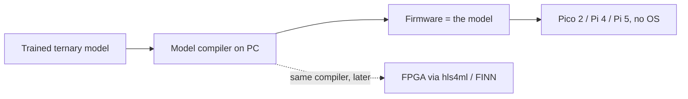

# Model as Firmware

Run small AI models **bare-metal** on cheap boards: no OS, no runtime, no model file. A compiler on the PC turns a trained ternary model (weights −1, 0, +1) into the firmware itself, using the chip's own hardware (both cores, SIMD/DSP, DMA, PIO). It is a software analogue of Taalas-style "model printed into the chip" hardware.

The plan starts on a Raspberry Pi Pico 2, then moves to a Pi 4 or Pi 5, and later an FPGA.

## Verdict

Feasible as a proof of concept, but expect a solid improvement over a standard embedded runtime on small models, not a Taalas-style 70x. The gain comes only from removing software overhead and memory traffic. The compiler is the lasting asset, since one front end can serve several back ends.

## Status

*As of 10 Nov 2026.* Research is done and Phase 0 is under way: steps 0–3 of 6 are complete, and Gate 0 is not reached yet.

- **Hardware:** one Pico 2 with headers, a micro-USB data cable, a USB power meter and a Pi 4. There's no Debug Probe, so flashing and the test link both go over the Pico's own USB. The rest of the shopping list hasn't been ordered.
- **Bring-up ([firmware/rp2350/hello/](firmware/rp2350/hello/)):** the firmware builds, flashes with `picotool` and prints over USB serial. The cycle counter reads 150,251 cycles for 1 ms at 150 MHz, and repeated runs vary by ±108 cycles out of 700k.
- **Training ([train/](train/README.md)):** BitNetMCU's ternary MNIST CNN reaches 99.45% final and 99.48% best, against 99.52% reported. Variants with 70% and 90% of the ternary-layer weights forced to zero lose no accuracy (99.44% and 99.50%).
- **Blocked:** the energy check (step 2b), because the power meter has a USB-C plug.

## Documents

| File | What's in it |
| --- | --- |
| [HANDOFF.md](HANDOFF.md) | Start here: status, decisions, step-by-step plan, open questions |
| [GETTING-STARTED.md](GETTING-STARTED.md) | Wiring for the hardware on hand, Phase 0 steps to Gate 0, progress log |
| [train/README.md](train/README.md) | How to reproduce the ternary MNIST training, local BitNetMCU patches, results |
| [FEASIBILITY-STUDY.md](FEASIBILITY-STUDY.md) | Prior art, verification findings, architecture, ideas A–H to test, risks, sources |
| [SHOPPING-LIST.md](SHOPPING-LIST.md) | No-solder parts for Phases 0–2 on the Pico 2 |

## Next steps

1. Unblock step 2b: get a USB-C adapter or cable for the power meter.
2. Phase 0 step 4: plain-C inference with packed weights on the Pico 2, matching PyTorch.
3. Phase 0 steps 5–6: CMSIS-NN int8 baseline and the PC test harness, which together reach Gate 0.
4. Phase 1: compiler v0, then idea A (all-code, all-data and hybrid builds) measured against CMSIS-NN.
