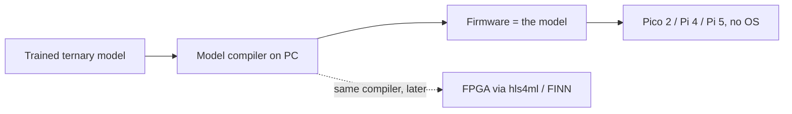

# Model as Firmware

Run small AI models **bare-metal** on cheap boards: no OS, no runtime, no model file. A compiler on the PC turns a trained ternary model (weights −1, 0, +1) into the firmware itself, using the chip's own hardware (both cores, SIMD/DSP, DMA, PIO). It is a software analogue of Taalas-style "model printed into the chip" hardware.

The plan starts on a Raspberry Pi Pico 2, then moves to a Pi 4 or Pi 5, and later an FPGA.

## Verdict

Feasible as a proof of concept, but expect a solid improvement over a standard embedded runtime on small models, not a Taalas-style 70x. The gain comes only from removing software overhead and memory traffic. The compiler is the lasting asset, since one front end can serve several back ends.

## Status

*As of 11 Nov 2026.* Phase 0 steps 0–6 are done. Gate 0 is met on correctness and baselines; only the energy measurement (step 2b) is left. **Phase 1 has started:** compiler v0 ([compiler/](compiler/README.md)) generates bit-exact firmware that runs at 8.83 ms from SRAM, 1.64x faster than the CMSIS-NN bar.

- **Gate 0 results ([results/](results/README.md)):** the plain-C reference on the Pico 2 is bit-exact with its golden model on all 10,000 test images: 99.47% accuracy, 10.21 ms per image (9.52 ms from SRAM). The CMSIS-NN int8 baseline with the same weights gets 99.44% at 18.70 ms (14.52 ms from SRAM). 14.52 ms is the speed bar for Gate 1.
- **Hardware:** one Pico 2 with headers, a micro-USB data cable, a USB power meter and a Pi 4. A Debug Probe and a USB-C cable for the meter are on order. Until they arrive, flashing and the test link both go over the Pico's own USB.
- **Bring-up ([firmware/rp2350/hello/](firmware/rp2350/hello/)):** the firmware builds, flashes with `picotool` and prints over USB serial. The cycle counter reads 150,251 cycles for 1 ms at 150 MHz, and repeated runs vary by ±108 cycles out of 700k.
- **Training ([train/](train/README.md)):** BitNetMCU's ternary MNIST CNN reaches 99.45% final and 99.48% best, against 99.52% reported. Variants with 70% and 90% of the ternary-layer weights forced to zero lose no accuracy (99.44% and 99.50%).
- **Waiting on parts:** the energy check (step 2b) needs the USB-C cable for the power meter.

## Documents

| File | What's in it |
| --- | --- |
| [HANDOFF.md](HANDOFF.md) | Start here: status, decisions, step-by-step plan, open questions |
| [GETTING-STARTED.md](GETTING-STARTED.md) | Wiring for the hardware on hand, Phase 0 steps to Gate 0, progress log |
| [train/README.md](train/README.md) | How to reproduce the ternary MNIST training, local BitNetMCU patches, results |
| [firmware/baselines/](firmware/baselines/README.md) | Plain-C reference and CMSIS-NN builds, build options |
| [harness/](harness/README.md) | PC test harness, golden models, CMSIS-NN exporter, live execution view (`bridge.py` + [ui/live.html](ui/live.html)) |
| [compiler/](compiler/README.md) | mafc: the model-as-firmware compiler (front end, IR, interpreter, RP2350 C back end) |
| [results/](results/README.md) | Measured numbers |
| [notes/](notes/README.md) | Research notes, how-tos and the dated lab log |
| [FEASIBILITY-STUDY.md](FEASIBILITY-STUDY.md) | Prior art, verification findings, architecture, ideas A–H to test, risks, sources |
| [SHOPPING-LIST.md](SHOPPING-LIST.md) | No-solder parts for Phases 0–2 on the Pico 2 |

## Next steps

1. When the cable arrives: step 2b (energy per inference), which completes Gate 0.
2. Phase 1: compiler v0, then idea A (all-code, all-data and hybrid builds), measured against the 14.52 ms CMSIS-NN bar.
3. Targets found by profiling: ternary decoding (about 8 cycles per weight) and the conv stack (about 70% of the time).
