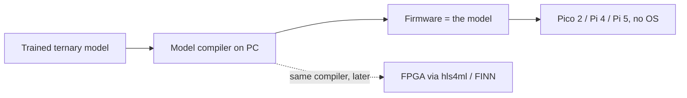
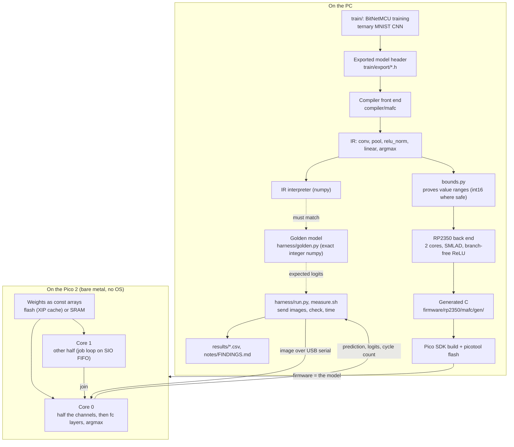

# Model as Firmware

Run small AI models **bare-metal** on cheap boards: no OS, no runtime, no model file. A compiler on the PC turns a trained ternary model (weights −1, 0, +1) into the firmware itself, using the chip's own hardware (both cores, SIMD/DSP and DMA so far; PIO is planned). It is a software analogue of Taalas-style "model printed into the chip" hardware.

The plan starts on a Raspberry Pi Pico 2, then moves to a Pi 4 or Pi 5, and later an FPGA.



## Verdict

Feasible as a proof of concept, but expect a solid improvement over a standard embedded runtime on small models, not a Taalas-style 70x. The gain comes only from removing software overhead and memory traffic. The compiler is the lasting asset, since one front end can serve several back ends.

## How it works



One inference: conv1 → dw1 → pool1 → dw2 → pool2 (run per channel, split across the two cores) → relu_norm → fc1 (ternary) → fc2 → fc3 → argmax. Every build has to match the golden model bit for bit on all 10,000 test images before its timing counts.

## Status

*As of 14 Nov 2026.* Phases 0, 1 and 3 are done on the Pico 2. **Gate 3 verdict** ([FINDINGS, "Gate 3"](notes/FINDINGS.md)): feasible as a proof of concept for speed on models that fit the Pico 2's SRAM; weights as code are shown on MNIST only, and there is no strong language-model baseline. Energy is not measured yet (see the bullets below). Every timed build matches its golden model bit for bit. All numbers come from one board, one training run per model, and the sources named. Unequal conditions are stated next to each number.

**Phase 1 (MNIST, against CMSIS-NN): Gate 1 met, with a stated scope ([FINDINGS F17](notes/FINDINGS.md)).**
- **Like for like (one core each, both from SRAM, 99.47% vs 99.44% accuracy):** the compiler's best-of build runs in **3.08 ms against CMSIS-NN's 14.52 ms, 4.7x faster** (F28, 25 Nov; 3.56 ms and 4.1x at the Gate 3 verdict).
- **Two cores:** 1.67 ms. That is 8.7x CMSIS-NN, but CMSIS-NN runs on one core; against a perfectly parallel two-core CMSIS-NN it would be at least 4.4x.
- **Memory:** the one-core build uses 137 KB of flash and 140 KB of SRAM, against CMSIS-NN's 94 KB and 127 KB. Compiling weights into code costs space.
- **Much of the MNIST lead comes from CMSIS-NN handling this model's shape badly** (a one-input-channel first conv and depthwise convs; F5).
- **On a wide conv, the shape CMSIS-NN is built for:** one synthetic layer with random ternary weights. Ternary-as-code breaks even at about 14% zero weights, wins 1.19x at 33% and 9x at 90%, and loses (0.86x) when no weights are zero (F17).
- **On an all-int8 version of the model:** level with CMSIS-NN on the linear layers, and 3.9x faster on one core overall, all of it from the conv stack (F24).
- **Idea A** (weights as code) is kept as a hybrid: linear layers as code, conv weights as data (F20).
- **Idea B** (a tree over neurons in place of fc1 + fc2; Belcak & Wattenhofer's fast feedforward networks), one training run:
  - Reads 6.6x fewer weights, for 0.30 points of accuracy (99.15% vs 99.45%).
  - The whole model gains little: 9% from SRAM. From flash it halves the time only against the twin with every layer stored as data in flash; against the twin's best flash build, it is 4% faster on one core and slower on two (F25).

**Phase 3 (a tiny story model): our own ternary byte-level model, MafLM, in dense and tree twins ([notes/lm.md](notes/lm.md), F26).**
- **The controlled comparison is twin against twin:** same runtime, data, budget and test text. The tree is **2.1x faster from SRAM and 2.5x from flash** (two cores, first 24 positions; 1.7x and 2.2x over the full 256 window), for +0.054 bits/byte (4.7%).
- **The tree runs at 310 tok/s** from SRAM on two cores over the first 24 positions, and 201 tok/s over the full 256-byte window.
- **Atome LM** (the published ternary story model) is an outside reference point only:
  - On our test text, both twins score 0.50–0.56 bits/byte better. If Atome's lower loss on its own data is all domain shift, the lead is about 0.30–0.36.
  - Atome's own engine runs at 0.71 tok/s on the same board. That speed gap compares engines, not models: about 15x of it is Atome's engine recomputing the context for every token, and our tok/s excludes the prompt. See "Fairness of the Atome comparison" in [notes/lm.md](notes/lm.md).

- **Gate 0 results ([results/](results/README.md)):** the plain-C reference on the Pico 2 is bit-exact with its golden model on all 10,000 test images: 99.47% accuracy, 10.21 ms per image (9.52 ms from SRAM). The CMSIS-NN int8 baseline with the same weights gets 99.44% at 18.70 ms (14.52 ms from SRAM). 14.52 ms is the speed bar for Gate 1.
- **Hardware:** one Pico 2 with headers, a Debug Probe (flashing over SWD), a USB power meter and a Pi 4.
- **Energy is not measured.** The USB meter reads only 0–4 mA, in 1 mA steps, for the Pico 2, so energy needs a finer instrument (an INA226 breakout or a Nordic PPK2). The tooling is ready: `harness/measure.sh energy` (see [harness/](harness/README.md)). Until then, no claim here is about efficiency, only speed.
- **Bring-up ([firmware/rp2350/hello/](firmware/rp2350/hello/)):** the cycle counter reads 150,251 cycles for 1 ms at 150 MHz, and repeated runs vary by ±108 cycles out of 700k.
- **Training ([train/](train/README.md)):** BitNetMCU's ternary MNIST CNN reaches 99.45% at the final epoch, against the 99.52% BitNetMCU reports. Our best epoch, 99.48%, was picked on the test set, so it is not a clean number. Variants with 70% and 90% of the ternary-layer weights forced to zero reach 99.44% and 99.50% (one run each).

## Watch it run

The easiest way in is the test launcher: run `train/.venv/Scripts/python.exe harness/launcher.py` and open http://127.0.0.1:8765. You choose:
- the test: MNIST digits or the tiny story model;
- where it runs: the golden model, the PC build, or the board;
- for the board, keep its current build, or pick any existing build for the launcher to flash first.

It then opens the matching live page, and each page links back. The bridge commands below start one view directly.

A browser view shows what the board computes as each test image goes through it: time per stage, each layer's feature maps, the ternary weights, and the logits against the golden model. From the repo root in Git Bash:

```bash
# on the board (Pico 2 on COM3, running any ref_c, cmsis_nn or mafc build)
train/.venv/Scripts/python.exe harness/bridge.py --target pico --port COM3
# without hardware: the C reference built for the PC, or the golden model alone
train/.venv/Scripts/python.exe harness/bridge.py --target host --exe firmware/baselines/ref_c/build-host/ref_host_tern80.exe
train/.venv/Scripts/python.exe harness/bridge.py --target golden
```

Then open http://127.0.0.1:8765 and stop it with Ctrl+C.

- **Modes:** Live, Slow-mo ×1000 (steps through one image's stages) and Replay.
- **Per-stage times:** need a `*_prof` build.
- **Sharing the board:** while the bridge runs it holds COM3, so stop it before a measurement. It won't start on the board while `run.py`, `measure.sh` or `picotool` is running.

Options and details are in [harness/README.md](harness/README.md#watching-a-run-live).

**The tiny story model** has its own page (`ui/story.html`). Flash a MafLM build and run `bridge.py --target pico --port COM3`, which switches to story mode by itself. Without hardware, use `--task story --target golden --npz train/runs/lm_tree.npz`. You type a prompt and watch the board write the story one byte at a time:
- each byte is checked bit-exact against the golden model;
- each byte shows its time on the board, its top candidates and the tree leaf each layer picked;
- the page also shows time per byte across the 256-byte window, stage shares, and the saved board runs with the fairness note on the Atome comparison.

## Documents

| File | What's in it |
| --- | --- |
| [HANDOFF.md](HANDOFF.md) | Start here: status, decisions, step-by-step plan, open questions |
| [GETTING-STARTED.md](GETTING-STARTED.md) | Wiring for the hardware on hand, Phase 0 steps to Gate 0, progress log |
| [train/README.md](train/README.md) | How to reproduce the ternary MNIST training, local BitNetMCU patches, results |
| [firmware/baselines/](firmware/baselines/README.md) | Plain-C reference and CMSIS-NN builds, build options |
| [harness/](harness/README.md) | PC test harness, golden models, CMSIS-NN exporter, live execution view (`bridge.py` + [ui/live.html](ui/live.html)) |
| [compiler/](compiler/README.md) | mafc: the model-as-firmware compiler (front end, IR, interpreter, RP2350 C back end) |
| [results/](results/README.md) | Measured numbers |
| [notes/FINDINGS.md](notes/FINDINGS.md) | All findings so far, with evidence, open questions and caveats |
| [notes/](notes/README.md) | Research notes, how-tos and the dated lab log |
| [FEASIBILITY-STUDY.md](FEASIBILITY-STUDY.md) | Prior art, verification findings, architecture, ideas A–H to test, risks, sources |
| [SHOPPING-LIST.md](SHOPPING-LIST.md) | No-solder parts for Phases 0–2 on the Pico 2 |

## Next steps

1. Energy per inference with a finer current meter (an INA226 breakout), which closes Gate 0.
2. Optionally, a model larger than SRAM on the Pico 2, where flash traffic sets the speed (ideas C and G on the story model's flash builds).
3. Phase 4 (bare-metal Pi 4) if you decide to go on; it needs the Pi 4's RAM size, a microSD card and a power supply.

## Licence

Apache-2.0 ([LICENSE](LICENSE)), covering the code, the generated firmware, the trained weights, the results and the docs. The exception is [train/bitnetmcu.patch](train/bitnetmcu.patch), a set of changes to the GPL-3.0 BitNetMCU, which is GPL-3.0. Third-party code and data are listed in [NOTICE](NOTICE).
