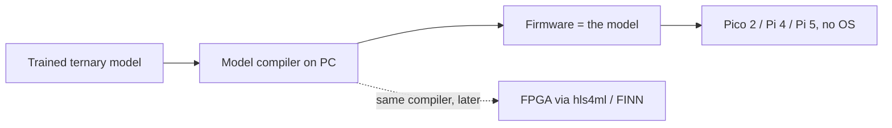

# Model as Firmware

Run small AI models **bare-metal** on cheap boards: no OS, no runtime, no model file. A compiler on the PC turns a trained ternary model (weights −1, 0, +1) into the firmware itself, using the chip's own hardware (both cores, SIMD/DSP, DMA, PIO). It is a software analogue of Taalas-style "model printed into the chip" hardware.

The plan starts on a Raspberry Pi Pico 2, then moves to a Pi 4 or Pi 5, and later an FPGA.

## Verdict

Feasible as a proof of concept, but expect a solid improvement over a standard embedded runtime on small models, not a Taalas-style 70x. The gain comes only from removing software overhead and memory traffic. The compiler is the lasting asset, since one front end can serve several back ends.

## Status

Research and feasibility are done. No code has been written yet, and the hardware has not been ordered.

## Documents

| File | What's in it |
| --- | --- |
| [HANDOFF.md](HANDOFF.md) | Start here: status, decisions, step-by-step plan, open questions |
| [FEASIBILITY-STUDY.md](FEASIBILITY-STUDY.md) | Prior art, verification findings, architecture, ideas A–H to test, risks, sources |
| [SHOPPING-LIST.md](SHOPPING-LIST.md) | No-solder parts for Phases 0–2 on the Pico 2 |

## Next steps

1. Order items 1–6 from the shopping list.
2. Phase 0: train a ternary MNIST model, reusing BitNetMCU's training code.
3. Phase 1: compile it to Pico 2 firmware and measure it against CMSIS-NN.
