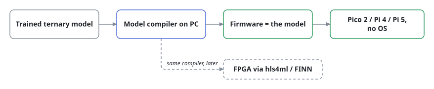
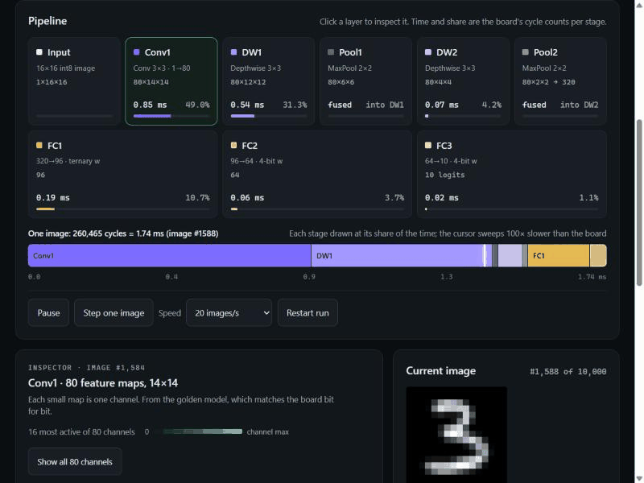

# Model as Firmware

Run small AI models **bare-metal** on a cheap microcontroller: no OS, no runtime, no model file. A compiler on the PC turns a trained ternary model (weights −1, 0, +1) into the firmware itself, using the chip's own hardware: both cores, the DSP instructions and DMA. It is a software take on "model printed into the chip" hardware such as Taalas.

<picture>
  <source media="(prefers-color-scheme: dark)" srcset="docs/diagrams/overview-dark.svg">
  
</picture>

**Verdict so far:** it works, and it is a solid speed-up over a standard embedded library on small models, but not a hardware-style 70x: the gain comes only from removing software overhead and memory traffic. The work so far is on a Raspberry Pi Pico 2. A Pi 4/5 and an FPGA are possible next steps.

## Tested on

- **Raspberry Pi Pico 2** (RP2350: two Cortex-M33 cores at 150 MHz, 520 KB SRAM), flashed over SWD with a **Raspberry Pi Debug Probe**.
- **A Windows 11 PC** for building and the test harness; an RTX 3060 Ti for training.
- One board, one training run per model. Details and wiring in [docs/HARDWARE.md](docs/HARDWARE.md).

## Results

Every build is checked **bit for bit** against an independent "golden" model on all 10,000 MNIST test images before its time counts.

| | Result | Details |
|---|---|---|
| Digit model (MNIST), one core, like for like | **3.08 ms** against 14.52 ms for Arm's CMSIS-NN library: **4.7x faster**, same accuracy (99.47% vs 99.44%) | [FINDINGS F28](notes/FINDINGS.md) |
| Same model, both cores | **1.67 ms** (CMSIS-NN runs on one core; against a perfect two-core CMSIS-NN it would still be ≥4.3x) | [Gate 1](notes/FINDINGS.md#gate-1) |
| The cost | about 1.5x CMSIS-NN's flash (137 vs 94 KB). Much of the lead comes from CMSIS-NN handling this model's layer shapes badly; on a wide conv layer, the gain ranges from 0.86x (no zero weights) to 9x (90% zeros). | [F5, F17](notes/FINDINGS.md) |
| Tiny story model, our own (MafLM) | the "tree" version runs at **310 bytes/s** and is **2.1x faster** than its ordinary twin from SRAM (2.5x from flash), for 4.7% worse text prediction | [notes/lm.md](notes/lm.md) |
| Energy | **not measured yet**: the USB meter used was too coarse. Every claim here is about speed. | [HARDWARE](docs/HARDWARE.md) |

All numbers, with their conditions and caveats: [results/](results/README.md) and [notes/FINDINGS.md](notes/FINDINGS.md).

## How it works

<picture>
  <source media="(prefers-color-scheme: dark)" srcset="docs/diagrams/how-it-works-dark.svg">
  
</picture>

New to the ideas (ternary weights, golden models, why flash speed matters)? [notes/EXPLAINER.md](notes/EXPLAINER.md) explains the project from zero.

## Try it

1. **Set up:** [docs/SETUP.md](docs/SETUP.md). You can watch the models run on your PC with no board at all.
2. **Reproduce the numbers:** [docs/REPRODUCE.md](docs/REPRODUCE.md), one recipe per claim, with the hardware each one needs and what you should see.
3. **Watch it run:** a browser view shows each image or story byte going through the model, checked live. What the pages show: [docs/UI-GUIDE.md](docs/UI-GUIDE.md).

## Repository

| Folder | What's in it |
|---|---|
| [compiler/](compiler/README.md) | mafc, the model-as-firmware compiler: front end, IR, interpreter, RP2350 C back end |
| [firmware/](firmware/baselines/README.md) | the compiled models, the plain-C and CMSIS-NN baselines, benchmarks |
| [harness/](harness/README.md) | PC side: golden models, the measurement scripts and the live views |
| [train/](train/README.md) | training the MNIST models (BitNetMCU) and the story models |
| [results/](results/README.md) | every measured number, as CSV |
| [notes/](notes/README.md) | findings, the dated lab log, design notes |
| [docs/](docs/) | setup, hardware, reproduction and UI guides; [the original plan](docs/history/plan.md) |
| [FEASIBILITY-STUDY.md](FEASIBILITY-STUDY.md) | the research before the project: prior art, ideas A–H, risks |

## Next steps

- Energy per inference, with a finer current meter (an INA226 breakout or a Nordic PPK2).
- A model larger than the Pico 2's SRAM, where flash bandwidth sets the speed.
- A bare-metal Raspberry Pi 4/5 back end.

## Licence

Apache-2.0 ([LICENSE](LICENSE)), covering the code, the generated firmware, the trained weights, the results and the docs. The exception is [train/bitnetmcu.patch](train/bitnetmcu.patch), a set of changes to the GPL-3.0 BitNetMCU, which is GPL-3.0. Third-party code and data are listed in [NOTICE](NOTICE).
