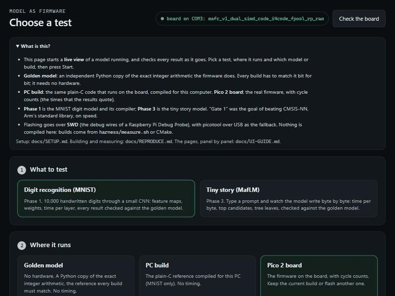
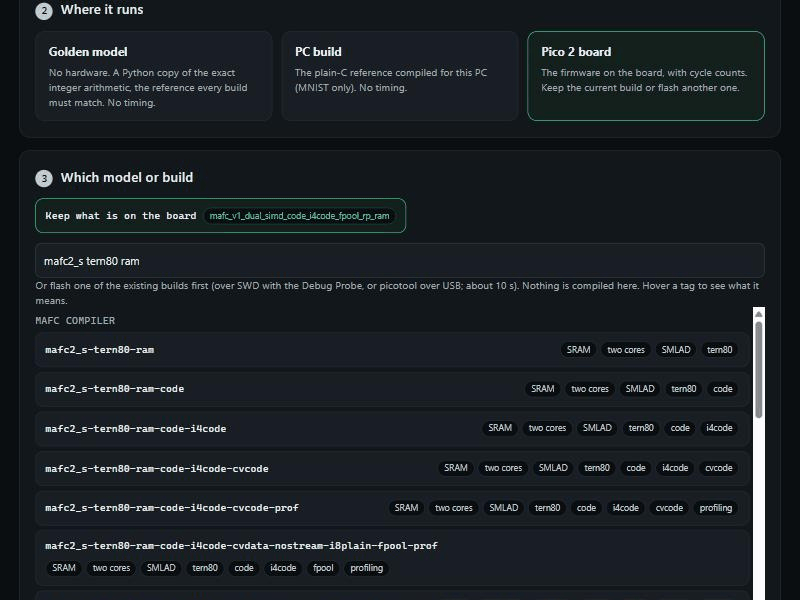
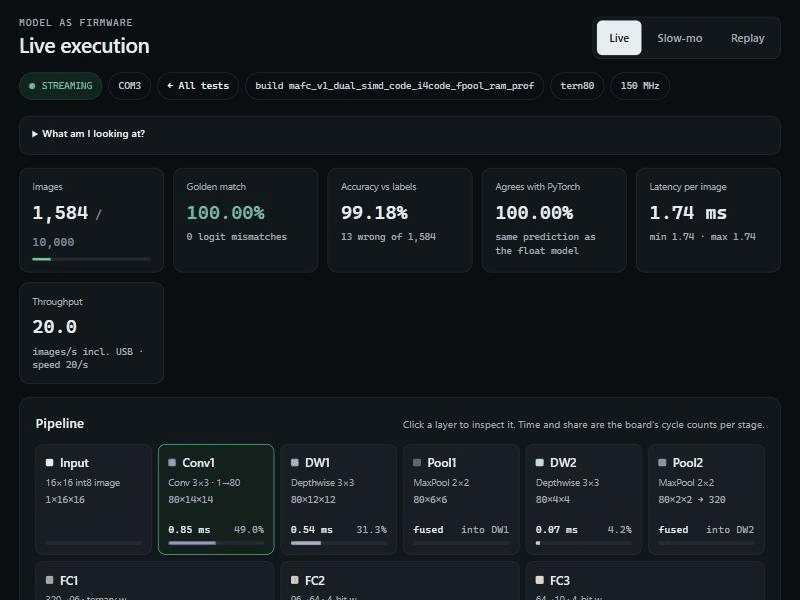
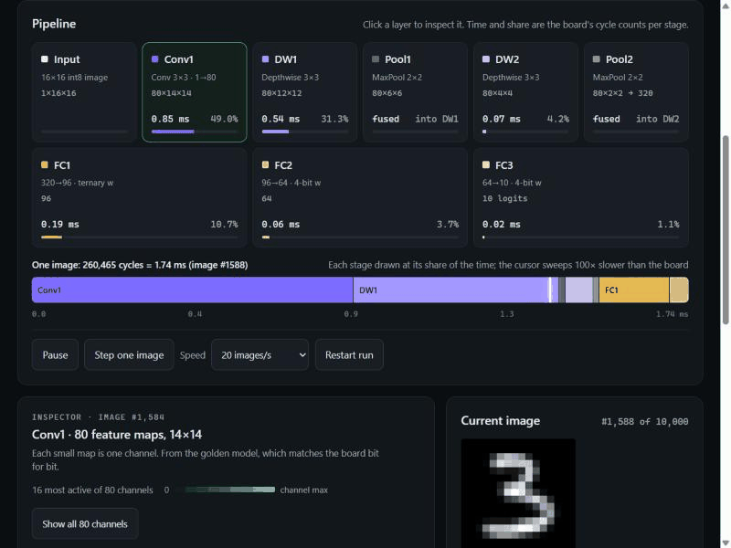
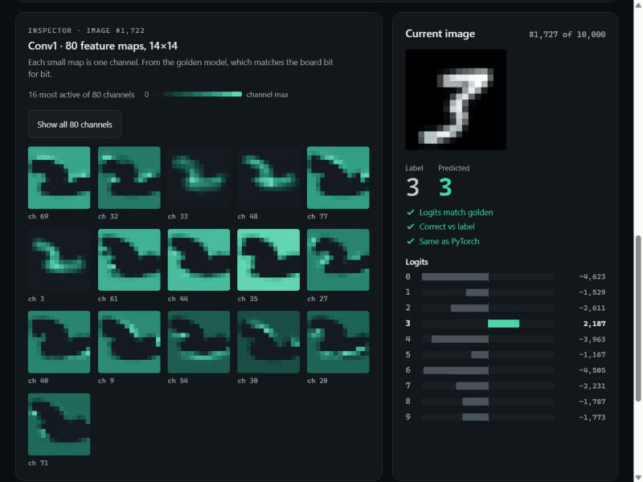
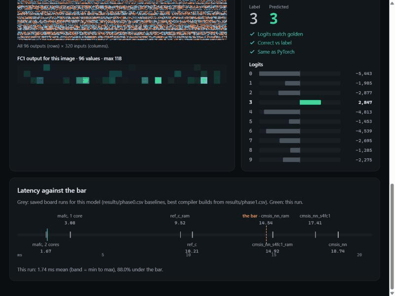
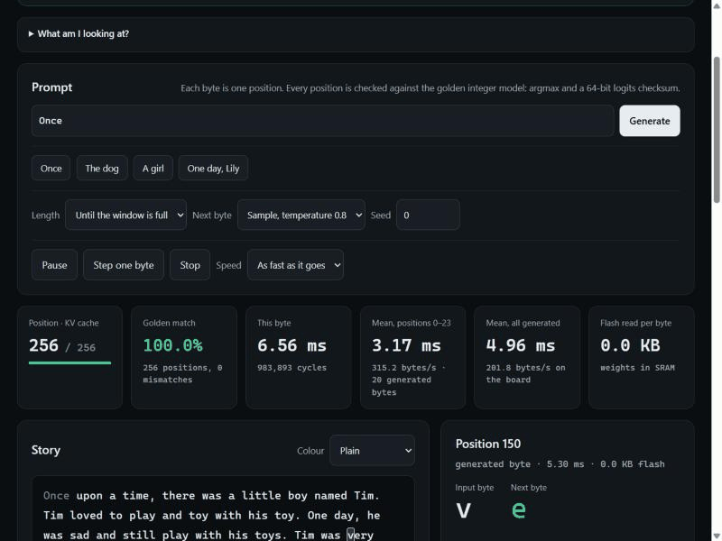
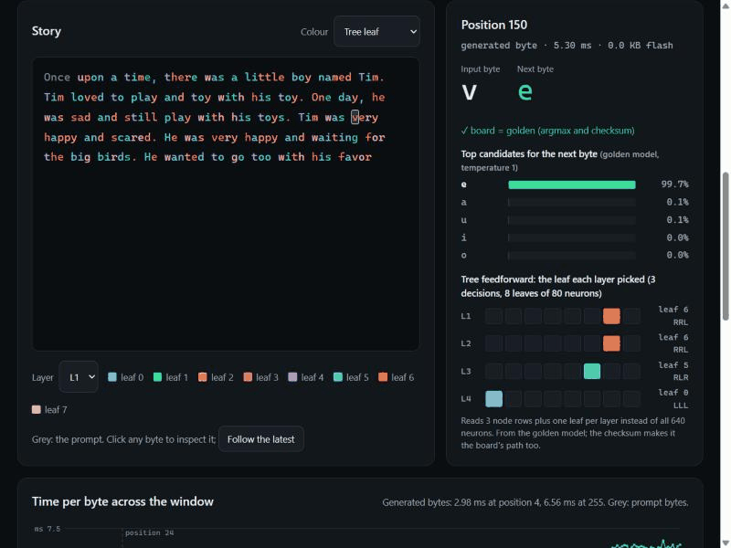
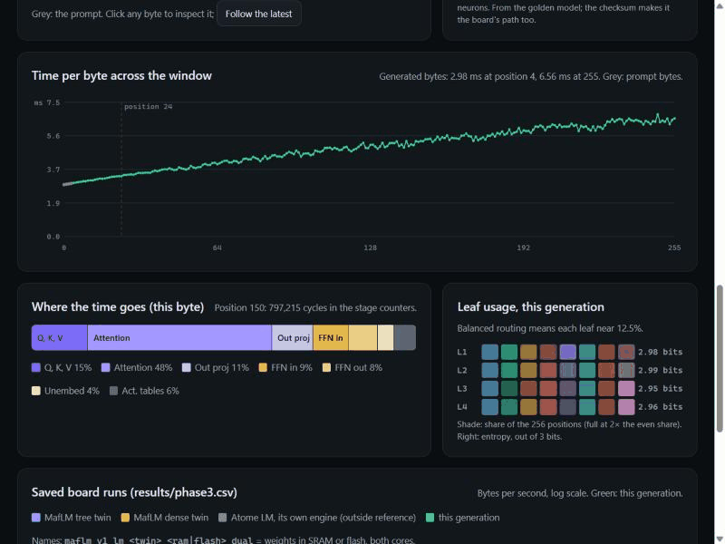
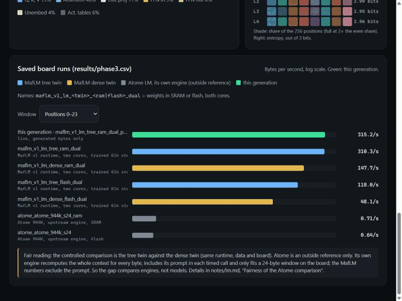

# The live views: a guide

The repo comes with a small browser UI for watching a model run and checking every result as it happens. It has three pages:

- **Test launcher**: choose what to run.
- **Live execution**: the MNIST digit model, image by image.
- **Tiny story**: the story model, byte by byte.

Each page has a "What am I looking at?" strip at the top with the short version of this guide.

Everything runs locally: a small Python web server on your PC (`127.0.0.1` only), with no internet access and nothing to install beyond [SETUP.md](SETUP.md).

## Starting it

```bash
python harness/launcher.py            # add --port COM5 (or /dev/ttyACM0) if your board isn't on the default port
```

Then open http://127.0.0.1:8765. Stop it with Ctrl+C in the terminal.

What each choice needs:

| Choice | Needs |
|---|---|
| MNIST, golden model | the MNIST test images ([SETUP.md](SETUP.md) section 3) |
| MNIST, PC build | the MNIST test images, plus a PC build of the C reference ([REPRODUCE.md](REPRODUCE.md), A) |
| MNIST, board | the MNIST test images, a Pico 2, and either an MNIST build already on it or build folders to flash |
| Story, golden model | a trained story model in `train/runs/` ([REPRODUCE.md](REPRODUCE.md), D1) |
| Story, board | the same, plus a story-model build on the board or to flash |

The launcher greys out a choice when something it needs is missing, and says what and where the instructions are.

---

## Test launcher



- **Board chip (top right):** what the launcher found on the serial port.
  - Green: the board answered and is running the build named on the chip.
  - Amber: the port is in use, either by the running test or by another program (a measurement, picotool). Hover the chip for details.
  - Red: no board found.
  - "Check the board" asks again.
- **1. What to test:** the digit model (MNIST) or the tiny story model (MafLM).
- **2. Where it runs:**
  - **Golden model:** an independent Python copy of the exact integer arithmetic the firmware does. Every build is checked against it bit for bit. It needs no hardware, but it has no timing.
  - **PC build:** the same plain-C code as the board's reference firmware, compiled for your computer. No timing either.
  - **Pico 2 board:** the real firmware, with the board's cycle counts. These are the times the results quote.
- **3. Which model or build** (MNIST models: tern80 is the main one, with a ternary FC1; tern80z70/z90 have 70% and 90% of FC1's weights forced to zero; int8_80 has all-int8 linear layers):



- **Choosing a build for the board:**
  - "Keep what is on the board" uses the current build, if it is the right kind for the test.
  - Or pick any build folder you've built (`build-*` folders with a `.uf2`). The launcher flashes it first: over SWD with the Debug Probe, or with picotool over USB.
  - The filter box matches words in the name and tags (`ram dual tree`).
  - Hover a tag to see what it means. They are listed under [Build tags](#build-tags) below.
- **Start** stops any running test, flashes if needed, starts the live view and opens it. **Stop** cancels at any point, including during flashing. **Log** shows the output, and opens by itself when something fails.

---

## Live execution (MNIST)



**Header:**
- **Live / Slow-mo / Replay** (the mode switch):
  - **Live** follows the run as images arrive.
  - **Slow-mo** steps the target one image at a time and moves a cursor through the layers. With a profiling build each layer takes its real share of the time, 1000x slower than the board; without one, one image takes 8 seconds and the layers are drawn at equal width. The inspector follows the cursor.
  - **Replay** steps back through the images already received.
- **Chips:**
  - the state (STREAMING, PAUSED, DONE, or DISCONNECTED);
  - the serial port;
  - **← All tests**, back to the launcher;
  - the build the board reports;
  - the model;
  - the clock (150 MHz).

**Summary tiles:**

| Tile | Meaning |
|---|---|
| Images | how many of the 10,000 test images have been through |
| **Golden match** | the correctness check: the share of images whose 10 output scores (logits) equal the golden model's exactly. Must stay at 100%; any mismatch pauses the run behind a red banner. Shows "n/a" when the target *is* the golden model. |
| Accuracy vs labels | right answers so far. About 99.4%: a few test digits are genuinely ambiguous. |
| Agrees with PyTorch | same prediction as the float model the weights came from: 99.98% over the full set, since integer rounding flips 2 images. Skipped if the BitNetMCU clone isn't there. |
| Latency per image | the board's own cycle count for one inference, converted to ms. Excludes USB. Board only. |
| Throughput | images per second actually shown, including USB round trips. The speed menu throttles it so you can watch. |



**Pipeline:**
- One block per layer, in order:
  - Conv1: a 3×3 convolution making 80 feature maps.
  - DW1 and DW2: depthwise convolutions, one 3×3 filter per channel.
  - Pool1 and Pool2: 2×2 max-pooling.
  - FC1, FC2 and FC3: fully connected layers. FC1's weights are ternary (−1, 0, +1); FC2 and FC3 are 4-bit.
- Each block shows the layer's output shape and, on a **profiling build** (`*_prof`), its time and share of the image.
- "fused into DW1" means the compiler merged that pooling step into the layer before it (`--fuse-pool`).
- The bar below the blocks is one image's time split by layer. The cursor shows that images are flowing; it isn't a measurement.
- **Controls:** Pause, Step one image, Speed (images per second), Restart run.



**Inspector (left):** what the selected layer computed for the current image. Click a block in the pipeline to change layer.
- **Conv/pool layers:** the feature maps, one small map per channel, brighter = larger. By default it shows the 16 channels with the most activity; "Show all 80 channels" shows the rest.
- **FC1:** the whole weight matrix, 96 rows (outputs) × 320 columns (inputs), coloured −1 / 0 / +1 with their counts, plus the 96 outputs for this image.
- **FC2/FC3:** their outputs.

These come from the golden model. Because the board's logits match it bit for bit, they are exactly what the board computed.

**Current image (right):**
- The 16×16 input digit, its label and the prediction (green if right, amber if wrong, red if the board disagrees with the golden model).
- Three checks: matches golden, correct, same as PyTorch.
- **Logits:** the 10 raw output scores; the prediction is the largest. A value that differs from the golden model is shown in red with the expected value next to it.



**Latency against the bar:** this run's time per image (green: the mean, with a band from the fastest to the slowest image), next to saved board runs for the same model:
- the Phase 0 baselines from `results/phase0.csv`:
  - `ref_c` is the plain-C reference;
  - `cmsis_nn` is Arm's CMSIS-NN library;
  - `_ram` means running from SRAM;
  - `s4fc1` is CMSIS-NN with a 4-bit FC1;
- the fastest compiler builds from `results/phase1.csv` (`mafc, 1 core` and `mafc, 2 cores`).

**The bar** (amber) is CMSIS-NN from SRAM, the speed the project set out to beat. The note under the chart says how far under or over it this run is. Hover a label to see the full build name.

---

## Tiny story (MafLM)

MafLM is a small ternary language model trained on children's stories. It reads and writes one byte (one character) at a time, with a 256-byte window. There are two versions trained the same way: the **dense twin**, with ordinary feedforward layers, and the **tree twin**, whose feedforward layers are small binary trees.



**Prompt:**
- Type up to 64 bytes, or pick a preset, and press **Generate**.
- **Length:** stop after N bytes, or run until the window is full.
- **Next byte:** **Greedy** always takes the top-scoring byte, as the timed runs do. **Sample** picks at random according to the scores; a higher temperature is more random, and the seed makes it repeatable. The board computes every byte either way; only the choice of the next one happens on the PC.
- Pause, Step one byte, Stop and Speed work as on the MNIST page.

Every position is checked: the board's top byte and a 64-bit checksum of all 256 scores must equal the golden model's. A mismatch pauses the run behind a red banner. If the board stops answering, the banner has a **Try again** button.

**Summary tiles:**

| Tile | Meaning |
|---|---|
| Position · KV cache | bytes processed so far, out of the window. The KV cache is the model's memory of earlier positions. |
| Golden match | the share of positions checked bit for bit ("n/a" when the target is the golden model) |
| This byte | board time for the selected or latest byte, with its cycle count |
| Mean, positions 0–23 | mean time per generated byte over the first 24 positions, the measure used in `results/phase3.csv` (24 is the window of the Atome reference) |
| Mean, all generated | the same over every generated byte |
| Flash read per byte | bytes fetched from flash per byte (from the chip's cache counters). 0 when the weights are in SRAM. |



**Story (left):**
- The text as it is written. Grey is your prompt.
- **Colour** can show:
  - the board time per byte;
  - which tree leaf a layer picked (choose the layer below);
  - the model's confidence.
- Click any byte to inspect it; "Follow the latest" goes back to live.

**Position (right):** the selected byte.
- Its input byte and the byte that came next.
- The check result.
- The top 5 candidates with their probabilities.
- For the tree twin, the leaf each of the 4 layers picked. The tree makes 3 left/right decisions (**L**/**R**) to choose 1 of 8 leaves of 80 neurons, so it reads about 1/8 of the feedforward weights. "leaf 6 RRL" means right, right, left.



- **Time per byte across the window:** board time for every position. It rises steadily because attention reads the whole KV cache, which grows by one entry per byte. Position 24 is marked.
- **Where the time goes (this byte):** the share of each stage, on profiling builds (`-DLM_PROFILE=ON`):
  - Q, K, V: the attention projections;
  - Attention: reading the KV cache;
  - Out proj: the attention output;
  - FFN in / FFN out: the feedforward layers;
  - Unembed: the 256 output scores;
  - Act. tables: building lookup tables of partial sums from each input vector, which replace most of the multiply-adds ([notes/lm.md](../notes/lm.md), "activation tables").
- **Leaf usage, this generation:** how often each leaf was picked in each layer. Even use (12.5% each, entropy near 3 bits) means the tree routes well and no leaf is wasted.



**Saved board runs:** bytes per second from `results/phase3.csv`, on a log scale, for the first 24 positions or the whole window, with this generation in green.
- Build names read `maflm_v1_lm_<twin>_<ram|flash>_dual`: which twin, weights in SRAM or flash, both cores.
- **The fair comparison is tree twin against dense twin** (same runtime, data and board).
- Atome LM is a published model run with its own engine, shown as an outside reference only. The note under the chart explains why its gap compares engines, not models.

---

## Build tags

The tags on build folders in the launcher, and the parts of folder names:

| Tag | Meaning |
|---|---|
| SRAM / flash | code and weights copied to the 520 KB of on-chip SRAM at boot, or run from external flash through a 16 KB cache |
| one core / two cores | one Cortex-M33 core, or the work split across both |
| SMLAD | uses the DSP instruction that does two 16-bit multiply-adds at once |
| profiling | per-stage cycle counters compiled in (a few % slower): needed for per-layer times |
| code | FC1's ternary weights compiled into instructions |
| dense / sparse / base3 | FC1 weights as plain arrays / non-zeros only / packed five per byte (the default) |
| i4code / i4dense | FC2/FC3 4-bit weights as instructions / as plain arrays |
| cvcode | conv weights as instructions |
| stream | dense layers streamed from flash with DMA |
| fpool / fpoolrp | each conv fused with the max-pool after it / plus conv1 computing two output rows per step |
| i8code / i8dense | int8 layers as instructions / as plain arrays |
| fc1 as s4 | CMSIS-NN with FC1 as 4-bit weights |
| tree / dense (story) | the tree twin or the dense twin |
| 2k-step check model | a short training run used to test the pipeline, not a result |

## Common problems

| What you see | Why, and what to do |
|---|---|
| A choice is greyed out with a note | A file it needs is missing; the note says which and links the setup step. |
| Board chip red, "not found" | Wrong port (start the launcher with `--port`), a charge-only USB cable, or the board isn't plugged in. |
| Board chip amber, "in use by …" | Another program holds the serial port, often a measurement. Wait for it, or stop it. |
| "port 8766 is in use" | An old live view is still running. Close it, or start the launcher with `--view-port 8770`. |
| "the board runs a MafLM story build" | You picked MNIST but the board has a story build (or the reverse). Flash a build of the right kind from the list. |
| No times per layer, "Flash a *_prof build" | Per-layer times need a profiling build. Build one with `harness/measure.sh profile …` (MNIST) or `-DLM_PROFILE=ON` (story). |
| Red "Correctness failure" banner | The board's output differs from the golden model. That's a real bug in the build: "Open in replay" shows the image and the differing scores. |
