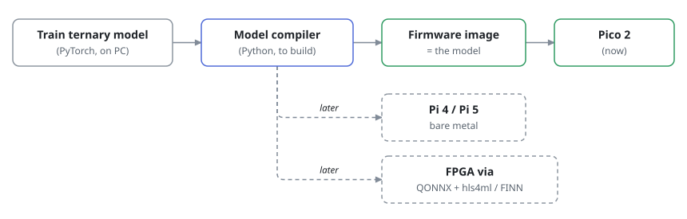
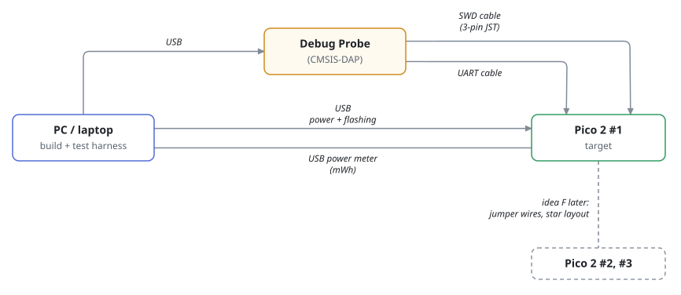
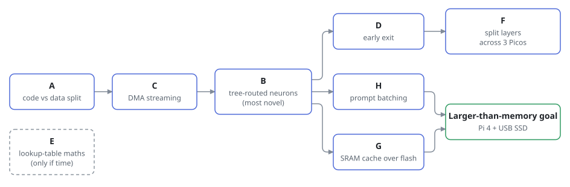

# Model as Firmware: the plan and how it went

*The project plan as written on 10 Nov 2026, before most of the code existed, with the progress table kept up to date to 25 Nov 2026. It is kept as a record of what was decided and in what order things were tried. For the current state, see the [README](../../README.md) and [notes/FINDINGS.md](../../notes/FINDINGS.md); for the research behind the plan, [FEASIBILITY-STUDY.md](../../FEASIBILITY-STUDY.md).*

## 1. The project in one paragraph

Run small AI models **bare-metal** on cheap boards: no OS, no runtime, no model file. A compiler on the PC turns a trained **ternary** model (weights −1, 0, +1) into the board's firmware, using every compute unit the chip has (so far both cores, DSP/SIMD instructions and DMA; PIO is planned). It is a software version of Taalas-style "model printed into the chip" hardware. The plan starts on a **Raspberry Pi Pico 2** and later moves to a Pi 4 or Pi 5, and eventually an FPGA.

<picture>
  <source media="(prefers-color-scheme: dark)" srcset="../diagrams/handoff-overview-dark.svg">
  
</picture>

## 2. Honest verdict

- **Feasible as a proof of concept.** People already run language models bare-metal on Pi 4, Pi 5, Pi Zero clusters and ESP32.
- **Don't expect Taalas-level gains.** Taalas gets ~70x by changing the silicon. Here the gain only comes from removing software overhead and memory traffic, so aim for "measurably better than CMSIS-NN at the same accuracy".
- **The flaw found in verification:** compiling every weight into an instruction costs 2–4 bytes per non-zero weight, against 2 bits when packed. That only pays off when the code fits in the 520 KB of SRAM. The design is therefore **hybrid**: structure as code, bulk weights as packed data. *(Measured later: about 6 bytes per non-zero weight (F16, F17). The hybrid that won (F20) puts the linear layers, whose weights are used once per inference, into code in SRAM, and keeps the conv weights, which are reused, as data.)*
- **Why work on it:** the compiler is the lasting asset, because one front end can serve many back ends. Ideas B (tree-routed neurons), F (split layers across boards for language models) and G (an SRAM working-set cache) had **no microcontroller prior art found**.
- **Why it might not pay off:** the building blocks already exist (Edge Impulse EON, TinyEngine, BitNetMCU, Atome LM at about 1 token/s on ESP32), so the novelty is in the combination and the results, not in any single trick.

## 3. Progress (10–25 Nov 2026)

| Area | Status |
| --- | --- |
| Research and feasibility | ✅ Done (feasibility study, prior art, verification, ideas A–H) |
| Hardware | ✅ One Pico 2 with headers, a micro-USB data cable, a Debug Probe (firmware v2.3.1, from 13 Nov) and a USB power meter (too coarse for the Pico 2). Extra Picos, breadboard and wires are needed only for idea F, not tried. See [docs/HARDWARE.md](../HARDWARE.md) |
| Pico bring-up | ✅ Builds, flashes over SWD with the Debug Probe (`harness/flash.sh`; picotool over USB as the fallback), prints over USB serial. The cycle counter reads 150,251 cycles for 1 ms at 150 MHz, ±108 cycles of jitter over 700k |
| Energy measurement | ⏳ Tooling ready 12 Nov. The USB meter turned out too coarse (reads 0–4 mA for the Pico 2, 1 mA / 1 mW / 1 mWh steps), so this needs a finer instrument (INA226 breakout or Nordic PPK2). Firmware command `L` runs inference back to back for N seconds; `harness/measure.sh energy results/energy.csv <spec>...` builds, flashes and walks through an idle and a busy phase per build, asking for the meter readings (`harness/energy.py`). Checked on the board without the meter (`--no-meter`) |
| BitNetMCU baseline | ✅ Reproduced: ternary CNN80 at 99.45% final / 99.48% best (99.52% reported). The 70% and 90% fc1-zero variants reach 99.44% and 99.50%. See `train/README.md` |
| Plain-C reference, CMSIS-NN baseline, harness | ✅ Done 11 Nov (steps 4–6). Bit-exact with golden models on 10k images. ref_c: 99.47%, 10.21 ms (9.52 ms from SRAM). CMSIS-NN int8: 99.44%, 18.70 ms (14.52 ms from SRAM, the Gate 1 bar). See `results/README.md` |
| Compiler v0 (Phase 1 step 7) | ✅ 11 Nov, branch `phase1-compiler-v0`. `compiler/mafc`: front end -> IR -> interpreter -> RP2350 C. Bit-exact on 10k images; 9.33 ms from flash, 8.83 ms from SRAM (1.64x faster than CMSIS-NN). Next: v1 optimizations and idea A (see `notes/compiler.md`) |
| Compiler v1, second core | ✅ 11 Nov. `--cores 2` splits conv channels and fc1/fc2 rows across both cores. Bit-exact; **4.80 ms from SRAM** (3.0x faster than CMSIS-NN on one core), 5.80 ms from flash. Next: SIMD (SMLAD, proven-safe int16) and idea A for fc1 |
| Compiler v1, SMLAD | ✅ 11 Nov. Bound analysis (`bounds.py`) proves int16 for conv1/dw1/pool1; SMLAD kernels for dw1 and dw2. Bit-exact; **4.36 ms from SRAM on two cores** (3.33x faster than CMSIS-NN on one core) |
| Compiler v1, branch-free ReLU | ✅ 11 Nov. The ReLU is written clamp-then-shift, so gcc emits no branch or IT block in the conv loops; this fixed conv1's int16 regression and most of v0's dw1 gap (FINDINGS F14). All mafc builds re-measured: **4.23 ms from SRAM on two cores** (3.44x faster than CMSIS-NN on one core). Next: conv1 SIMD, then fc1 formats and idea A |
| Compiler v1, conv1 SMLAD + kernel v2 | ✅ 11 Nov. conv1 runs SMLAD on an int16 copy of the image, widened once per inference. The SMLAD kernel was rewritten to fit in registers: (k0,k1)/(k1,k2) packing, `USAT` ReLU, no spills (FINDINGS F15). Bit-exact; **3.05 ms from SRAM on two cores** (4.76x faster than CMSIS-NN on one core), 4.38 ms from flash. fc1 is now the largest stage. Next: fc1 formats and idea A |
| Compiler v1, fc1 formats / fc1 as code | ✅ 11 Nov. `--ternary {base3,sparse,code,dense}`. Code (idea A) wins: fc1 is 5x faster from SRAM, and it scales with sparsity (z90: fc1 11k vs 131k cycles). The code goes to SRAM even in flash builds (FINDINGS F16). Bit-exact; **2.32 ms from SRAM on two cores** (6.25x faster than CMSIS-NN on one core), 2.89 ms in a flash build. RAM accounting fixed in `run.py`. Next: core balance, fc2, pool1 |
| Fairness check, Gate 1 | ✅ 11 Nov. The CMSIS-NN baseline is at its best for these shapes (audit). One core against one core: 3.75x. Wide-conv microbenchmark (`firmware/bench/conv_wide`): weights-as-code beats CMSIS-NN 1.19x / 1.65x / 2.7x / 9x at 33/50/70/90% zeros and loses 0.86x when dense. fc2/fc3 (int4) are still 3.6x slower than CMSIS-NN. **Gate 1 met**, with that scope (FINDINGS F17). Energy still open |
| Gate 0 | ⏳ Met except energy: the USB-C cable and Debug Probe arrived (13 Nov), but the USB meter is too coarse for the Pico 2, so step 2b needs a finer instrument |
| Compiler v1, fc2/fc3 as code | ✅ 12 Nov. `--int4 {packed,code,dense}`. fc2 as code is 3.4x faster (59k → 17k cycles), level with CMSIS-NN. Bit-exact; **2.15 ms from SRAM on two cores** (6.77x against one-core CMSIS-NN), **3.56 ms on one core (4.08x like-for-like)**; flash builds 2.35 / 3.59 ms (FINDINGS F18) |
| Idea A three-way test; join fix | ✅ 12 Nov. All-data / hybrid (linear as code) / all-code (`--conv code`): the hybrid is fastest from flash and ties all-code from SRAM with less flash, so **keep the hybrid** (FINDINGS F20). The two-core join wait was a worse inlined copy of the conv kernel on core 1; with a shared `noinline` kernel it is **1.99 ms from SRAM on two cores** (7.28x against one-core CMSIS-NN), 2.27 ms from flash (F19). Next: PR to main, then idea C |
| Flash traffic measured | ✅ 12 Nov. XIP counters around every `ref_infer()` (`X` command); `flash_read_kb` is filled at last. Per inference: hybrid 1.2 KB, all-data 7–13 KB, CMSIS-NN 45.5 KB (29.6 KB with its 4-bit kernel for fc1, F27), all-code 49 KB. The hybrid reads less from flash because it keeps its linear layers as code in SRAM (134 KB of RAM, against CMSIS-NN's 33 KB in its flash build); a miss costs ~65–110 cycles (FINDINGS F22) |
| int8 layers, 4-row dense kernel | ✅ 12 Nov. `int8_80` model (all linear layers int8, 99.43%). `--int8 {plain,dense,code}`. With the dense kernel doing 4 rows at a time, int8 linear layers are level with CMSIS-NN (fc2 16.5k vs 16.4k cycles, fc1 76k vs 71k); the whole int8 model is 3.73 ms on one core (3.90x) and 2.12 ms on two (6.86x against one-core CMSIS-NN), the lead coming from the conv stack. Code doesn't pay for int8 from SRAM (FINDINGS F24) |
| Idea B: tree over neurons | ✅ 13 Nov. `fff80`: fc1 + fc2 as a depth-3 fast feedforward tree (8 leaves of 12; fast feedforward networks are Belcak & Wattenhofer's, 2023). 99.15% vs the dense twin's 99.45%, one training run each. Reads 6.6x fewer weights. The tree layer is 3.8x faster from SRAM, and from flash 3.4x (twin's linear layers as code in SRAM) to 6.2x (twin's stored as data in flash). Whole model: 3.23 vs 3.56 ms on one core from SRAM (9%). From flash, 4.09 vs 8.05 ms against the twin stored as data in flash, but only 3.45 vs 3.59 ms against the twin's best flash build; on two cores from flash the tree was slower (2.57 vs 2.28 ms, a storage-format difference). Training needed a load-balancing loss (the first run collapsed to one leaf). **Keep** (FINDINGS F25). Next: the tiny story model |
| Idea C in the compiler | ✅ 12 Nov. `--stream`: dense-format layers stream their weights from flash (XIP FIFO, DMA, double buffer). fc1 (30 KB) from flash: 308k → 219k cycles on one core; whole model 6.29 → 5.12 ms (one core), 6.65 → 3.97 ms (two cores). Code in SRAM is still best for MNIST (FINDINGS F23) |
| Idea C: DMA streaming | ✅ 12 Nov. Benchmark `firmware/bench/stream`: for a 64 KB layer in flash, double-buffered DMA from the XIP stream FIFO is **31% faster** than reading through the cache, and DMA from the uncached alias is slower. **Keep** (FINDINGS F21). Later added to the compiler as `--stream` (see "Idea C in the compiler", F23). The RP2350 has XIP counters after all (`ctr_hit`/`ctr_acc`) |
| MafLM: own tiny story model (Phase 3) | ✅ 13–14 Nov. Ternary, byte-level, about 0.92M weights, dense and tree twins trained on 2B bytes of TinyStories V2. On the held-out test slice: dense 1.165, tree 1.219 bits/byte. Bit-exact on the PC and on the Pico 2. Two cores from SRAM, first 24 positions: tree 310 tok/s, dense 148 (over the full 256-byte window: 201 and 117). The tree is 2.1–2.5x faster than its twin over the first 24 positions (1.7–2.2x over the full window) for +0.054 bits/byte. Atome is an outside reference point only; caveats in `notes/lm.md`, "Fairness of the Atome comparison" (FINDINGS F26) |
| CMSIS-NN with 4-bit fc1 | ✅ 14 Nov (fairness check, F27). fc1 as `arm_fully_connected_s4` on the same ternary weights, bit-exact. From flash it is 7% faster (17.41 ms); from SRAM 3% slower (14.92 ms), so the Gate 1 bar stands. Our flash ratios shrink by about 7%. fc2/fc3 can't use s4 (levels ±1…±15) |
| Best-of build | ✅ 25 Nov. `--fuse-pool --row-pairs`: max pools fused into the convs, conv1 two rows per step, fc2/fc3 dense. **1.67 ms from SRAM on two cores, 3.08 ms on one core (4.72x like for like)**, 1.99 ms two cores from flash; tree 1.53 ms. Bit-exact on 10k images (FINDINGS F28) |
| Gate 1 | ✅ Met 11 Nov at equal accuracy: 3.75x one core against one core (4.08x after F18, 4.72x after F28), 6.25x with both cores against CMSIS-NN on one core (6.77x after F18, 8.69x after F28). Scope in FINDINGS F17 and "Gate 1": much of the MNIST lead comes from CMSIS-NN's weak kernels for this model's shape (F5), and the faster builds use more flash and SRAM than CMSIS-NN. Energy not yet measured |
| Atome LM baseline | ✅ Reproduced 13 Nov: bit-exact on the PC and on the Pico 2, 1.711 bits/byte on our test text, 0.71 tok/s with its own engine (which recomputes the context for every token). Used as an external yardstick only; the comparison's caveats are in `notes/lm.md`, "Fairness of the Atome comparison" |
| Gate 3 (end of the Pico phases) | ✅ Verdict 14 Nov: **feasible as a proof of concept for speed, on models that fit the Pico 2's SRAM.** Gates: 0 met except energy; 1 met with a stated scope; 2 partly (idea D and PIO not tried); 3 met, not like for like. Limits: energy not measured; weights as code shown on MNIST only (all of the story model's ~530K non-zero weights would take ~3 MB as code; code for its small matrices was not tried); no strong language-model baseline. Phase 4 is an open decision; recommended first: energy (INA226), then optionally a model larger than SRAM on the Pico 2 (FINDINGS, "Gate 3") |

*The dated, step-by-step lab log is [notes/LOG.md](../../notes/LOG.md).*

## 4. Decisions already made

1. **Start on the Pico 2 (RP2350)**: 520 KB SRAM, 4 MB flash, two Cortex-M33 cores with DSP, 12 PIO state machines, DMA.
2. **No soldering.** Buy the Pico 2 *with headers* and use only plug-in parts.
3. **Leave the ESP32-S3 comparison board for later.** The Pimoroni Pico Plus 2 (8 MB PSRAM) is also for later, for idea G.
4. **Ternary (BitNet b1.58-style) weights**, trained in, not quantised after training.
5. **Hybrid layout:** code for structure, packed weights as data, and only small hot weights as instructions (idea A). *Revised by measurement (F20): the linear layers become code in SRAM, and the conv weights stay as data.*
6. **Reuse, don't rebuild:** BitNetMCU's training code for Phase 0, Atome LM as the language-model baseline, and hls4ml or FINN for the FPGA phase.
7. **Every idea is an experiment** with a "keep if" threshold. Nothing replaces the base design unless it measurably wins.

## 5. Hardware setup (as planned)

<picture>
  <source media="(prefers-color-scheme: dark)" srcset="../diagrams/hardware-setup-dark.svg">
  
</picture>

- The Debug Probe gives SWD debugging (breakpoints, step through) and a UART serial link to the Pico without soldering.
- **Pi 4 later:** a spare Pico can act as a JTAG probe for the Pi 4. Run dirtyJtag or JTAGprobe firmware on it, set `enable_jtag_gpio=1` in `config.txt`, and use GPIO 22–27.

## 6. Where to start: Phase 0 and Phase 1 step by step

<picture>
  <source media="(prefers-color-scheme: dark)" srcset="../diagrams/first-steps-dark.svg">
  
</picture>

1. **Toolchain.** Install the Pico SDK, `arm-none-eabi-gcc`, CMake, `picotool` and the Raspberry Pi fork of OpenOCD. The VS Code "Raspberry Pi Pico" extension installs all of these at once. Build with `PICO_BOARD=pico2`. Debug with `openocd -f interface/cmsis-dap.cfg -f target/rp2350.cfg`.
2. **Blink and UART "hello"** to prove that flashing, debugging and serial all work.
3. **Clone [BitNetMCU](https://github.com/cpldcpu/BitNetMCU)** and train its ternary MNIST model on the PC. Also train variants at about 70% and about 90% zeros, for the sparse-storage experiment.
4. **Write a plain-C reference inference** on the Pico 2 with packed 2-bit weights. This is the correctness anchor.
5. **Build a [CMSIS-NN](https://github.com/ARM-software/CMSIS-NN) int8 baseline** for the same task. This is the speed bar to beat, so the comparison is honest.
6. **Write a test harness:** a Python script sends inputs over UART, reads outputs and cycle counts, and compares them with PyTorch.
7. **Compiler v0 (Python):** read the trained model and emit one C function per layer with fixed addresses. Keep a small intermediate format so back ends can be swapped later.
8. **Idea A experiment:** build all-weights-as-code, all-packed-data and the hybrid. Measure flash size, bytes read and cycles.

**Log these for every build** (same table throughout):

| Metric | Unit |
| --- | --- |
| Latency per inference / per token | ms |
| Accuracy vs PyTorch | % match |
| Flash and RAM used | KB |
| Bytes read from flash per inference | KB |
| Energy per inference | mJ (needs a finer meter than the USB one: INA226 or PPK2) |
| Gain vs previous step | x |

## 7. After Phase 1: idea test order

<picture>
  <source media="(prefers-color-scheme: dark)" srcset="../diagrams/idea-order-dark.svg">
  
</picture>

| Idea | One-line test | Keep if (starting target) |
| --- | --- | --- |
| A Structure as code | 3 builds of the same model | Hybrid ≥ the faster of the other two, with less flash |
| B Tree over neurons | Tree layer vs dense twin, then a tiny story model | ≥3x fewer bytes and lower latency, <1 point accuracy loss |
| C DMA streaming | Double-buffered vs not | ≥20% lower latency |
| D Early exit | 2 exit heads, sweep the threshold | ≥25% lower average latency, <1 point loss |
| E Lookup tables | Separate experiment | Only if time allows |
| F Split layers | Same model on 1, 2 and 3 Picos | 3 boards ≥2x faster than 1 |
| G SRAM cache | Cache 0/64/128/256 KB, ± prefetch | ≥50% hit rate and ≥1.5x speed-up |
| H Prompt batching | Batch prompt tokens on the tiny story model | Faster time to first token |
| Big-model goal | Pi 4 + USB 3 SSD, model > RAM | ≥1 token/s with a model ≥2x RAM |

## 8. Known risks to keep in mind

- **Flash bandwidth is the bottleneck,** not compute. Measure bytes read, not only speed.
- **Ternary models must be trained as ternary.** Tiny models write simple text, so pick tasks that fit (digits, keywords, short stories).
- **Tree routing (B) is unproven for small text-generating models.** UltraFastBERT understands text but does not generate it.
- **Bare metal on the Pi is a big job:** InferPi had to write its own USB, PCIe and FAT32 drivers. Run the Pi experiments under Linux first.
- **The Pi 4 SSD tops out around 300–360 MB/s** whatever drive you use, because every Pi 4 M.2 board is USB underneath. A Pi 5 with the M.2 HAT+ (up to about 800–900 MB/s in Gen 3 mode) is the real upgrade, and only worth it if the link proves to be the limit.

## 9. Suggested code repo layout (as planned; the real layout is close)

```
model-as-firmware/
├── train/            # PyTorch ternary training (from BitNetMCU), export
├── compiler/         # Python: model → IR → C/asm per back end
│   ├── frontend/     # reads trained model into IR
│   └── backends/     # rp2350/, (later) pi4/, fpga-qonnx/
├── firmware/
│   ├── rp2350/       # Pico SDK project: boot, kernels, UART protocol
│   └── baselines/    # plain-C reference, CMSIS-NN build
├── harness/          # PC scripts: send inputs, read outputs, compare, log CSV
└── results/          # one CSV per experiment, same metric columns
```

## Key links

- Docs: [Feasibility study](../../FEASIBILITY-STUDY.md) · [Hardware](../HARDWARE.md)
- Baselines: [BitNetMCU](https://github.com/cpldcpu/BitNetMCU) · [Atome LM](https://github.com/TilelliLab/atome-lm) · [CMSIS-NN](https://github.com/ARM-software/CMSIS-NN) · [ESP32-S3 LLM Cluster](https://github.com/Low-Zi-Hong/ESP32s3-LLM-Cluster) · [InferPi](https://github.com/siddharthjthapa/InferPi)
- Techniques: [UltraFastBERT / FFF](https://arxiv.org/abs/2311.10770) · [CALM early exit](https://proceedings.neurips.cc/paper_files/paper/2022/hash/6fac9e316a4ae75ea244ddcef1982c71-Abstract.html) · [Sherry N:M ternary](https://arxiv.org/pdf/2601.07892) · [WiCi InferSSD](https://wici.ai/article/running-800b-models-with-inferssd)
- FPGA later: [hls4ml](https://fastmachinelearning.org/hls4ml/) · [FINN](https://xilinx.github.io/finn)
